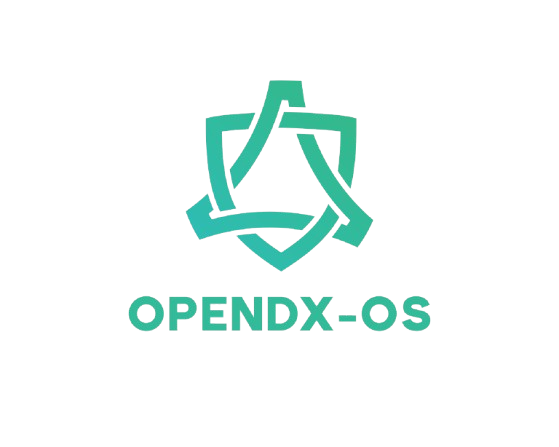
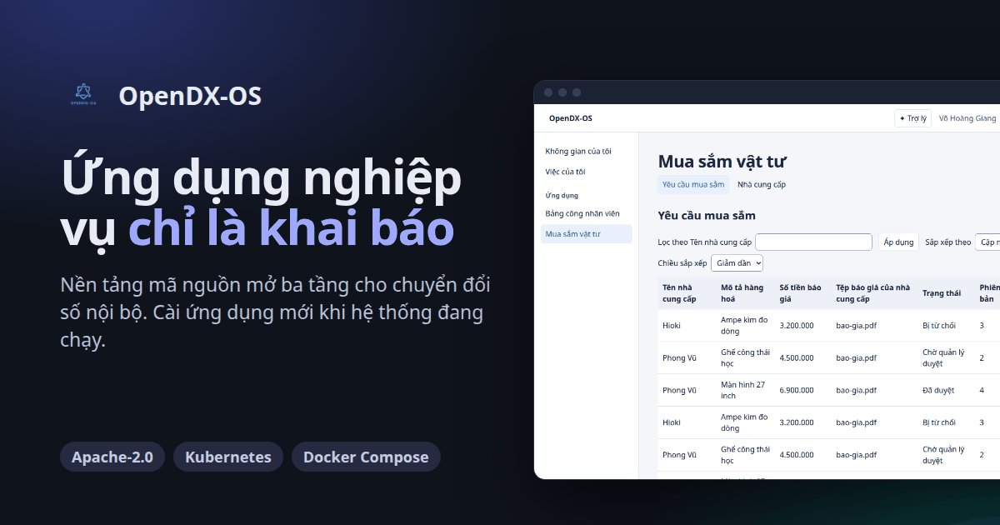
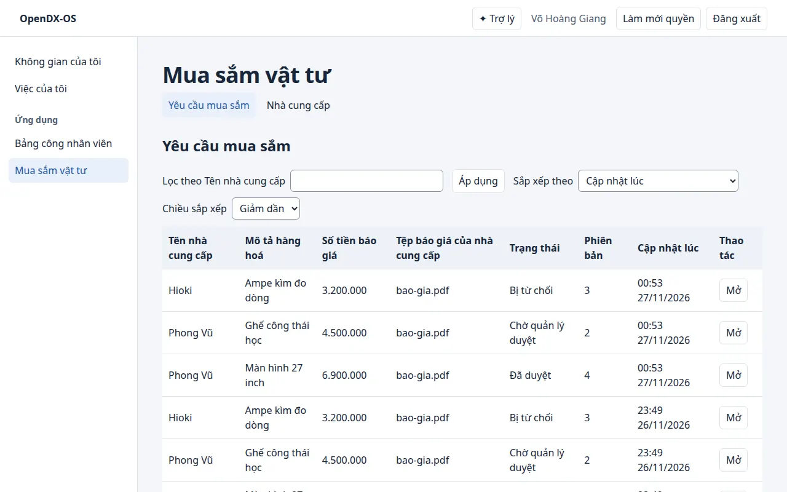
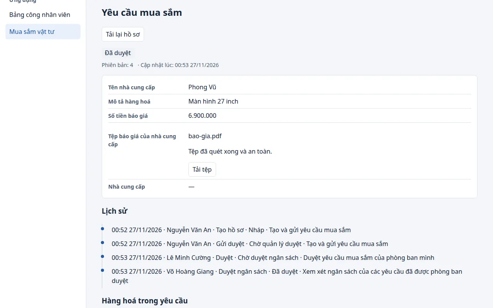
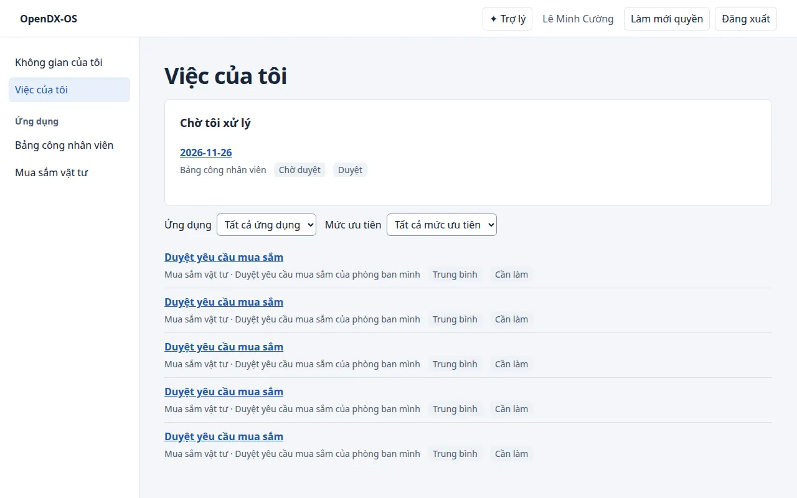
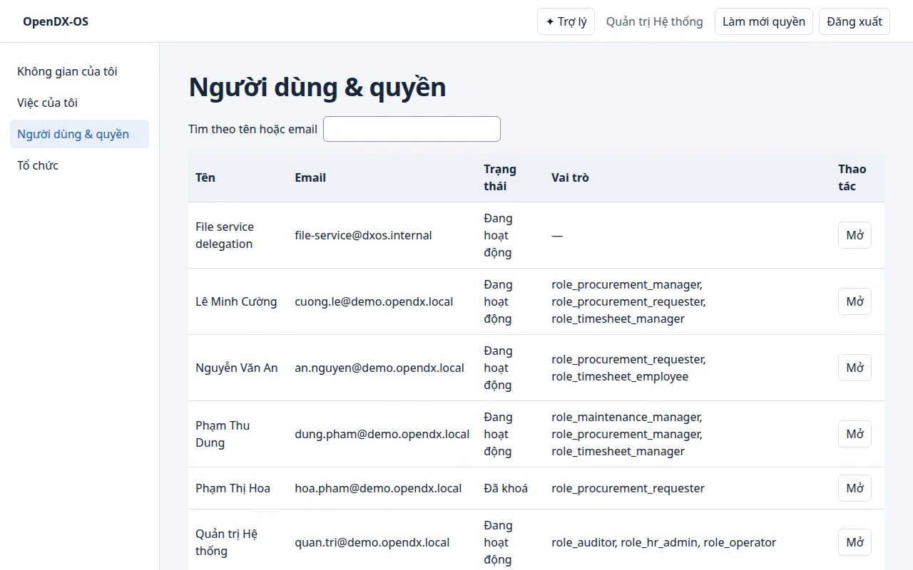

<div align="center">



### One digital platform for every internal application

*Each application is just a declarative package: data, roles and approval flow.<br>
OpenDX-OS turns that package into a complete application and installs it while the system is running.*

[](LICENSE)
[](https://github.com/nguyentin05/opendx-os/actions/workflows/ci.yml)
[](https://github.com/nguyentin05/opendx-os/releases)
[](operator/go.mod)
[](https://nguyentin05.github.io/opendx-os/en/get-started/)
[](https://discord.gg/Mt7zskvcpU)

[Tiếng Việt](README.md) | **English**

[Website](https://nguyentin05.github.io/opendx-os/) ·
[Documentation](https://nguyentin05.github.io/opendx-os/en/get-started/) ·
[Quick start](#quick-start) ·
[Roadmap](ROADMAP.en.md) ·
[Contributing](CONTRIBUTING.en.md)

</div>

> **TL;DR:** **OpenDX-OS** is an open-source, self-hosted platform that brings an organization's internal processes, such as procurement, equipment maintenance and timesheets, onto one system. Sign-in, authorization, storage, approval flows and the user interface come from the platform; each application declares only its business part in a `manifest.yaml`. The same configuration runs with **Docker Compose** on one machine or on **Kubernetes** (EKS, GKE, AKS, on-premises). Developed for the **OLP Open Source Software 2026** competition.

<div align="center">

</div>

---

## What is OpenDX-OS?

Every internal process tends to bring its own software, so accounts, permissions and data end up scattered, and it is hard to know who may do what and who did what. OpenDX-OS gathers the parts every application needs into one shared platform. An organization describes each process as a declarative package: its data tables, roles, the columns each role may see, the states and the commands that move between them. The operator reads that package and creates the tables, permissions, approval flows and roles; the workspace then builds lists, forms and detail pages for each person's role.

---

## Core capabilities

### Applications are declarations
- **Install while the system runs:** copy a package into `apps/` (Compose) or `kubectl apply` a `DXApplication` (Kubernetes); the application is ready in under 30 seconds, with no build and no redeployment.
- **Controlled state machine:** each command declares its source states, target state, allowed roles and record filter, so for example a manager cannot approve their own request.
- **Drift repair:** the controller compares the live configuration with the package and restores permissions or metadata changed by hand.

### Shared platform (Tier 1)
- **One sign-in, one place to grant access:** Keycloak authenticates; `dxos-authz` checks every request by role and department, and a revoked permission takes effect almost immediately.
- **Data with a full history:** PostgreSQL with a version check on every command, so a command based on an old version is refused instead of overwriting; each step records who acted, when and in which role.
- **APIs behind one gateway:** APISIX fronts Hasura (GraphQL, with live updates) and the services; Kestra runs approval flows; SeaweedFS stores files and ClamAV scans them before they can be downloaded.

### Shared H-P-D-I capabilities (Tier 2)
- **Human (H):** departments and employees, which decide who sees which data.
- **Process (P):** commands, attachments, history, and My Work for each person.
- **Data (D):** equipment data (in progress, see the [roadmap](ROADMAP.en.md)).
- **Intelligence (I):** an Assistant that answers from the organization's documents with citations, and a personal library.

### Operations
- **Compose and Kubernetes stay in step:** one configuration, checked automatically so the two deployments do not drift apart.
- **Scale to zero when idle:** on Kubernetes, KEDA scales the process service to zero without work and back up on the next request.
- **Observable:** traces, metrics and logs following OpenTelemetry.
- **Secure by default:** secrets generated at installation; every change is scanned with gitleaks, Trivy and CodeQL; images carry attestations.

---

## Screenshots

| Lists by role | Record and history |
| :---: | :---: |
|  |  |
| **My Work** | **Users and permissions** |
|  |  |

The interface is in Vietnamese.

---

## Three-tier architecture

| Tier | Role | Components |
| :--- | :--- | :--- |
| **3 · Applications** | Declarative packages, installed and removed while the system runs | Procurement, Equipment maintenance, Timesheets |
| **2 · Shared capabilities** | Written once, used by every application | `cap-hr`, `cap-process`, `cap-ai`, My Work, Workspace UI |
| **1 · Core platform** | No user interface, APIs only; every request is authorized | PostgreSQL, Hasura, Keycloak, `dxos-authz`, APISIX, Kestra, SeaweedFS, ClamAV |

Details in the [architecture](docs/architecture/index.md) and the [ADRs](docs/adr/index.md).

---

## Deployment targets

| Target | How | Notes |
| :--- | :--- | :--- |
| **One machine** | Docker Compose | Trial and development; ports bind to 127.0.0.1 by default |
| **Amazon EKS** | Kustomize overlay `deploy/k8s/overlays/eks` | A demo cluster runs on it |
| **Google GKE** | `deploy/k8s/overlays/gke` | Example configuration |
| **Azure AKS** | `deploy/k8s/overlays/aks` | Example configuration |
| **On-premises** | `deploy/k8s/overlays/onprem` | Self-managed Kubernetes cluster |

See [installation](docs/operations/installation.md) and [Kubernetes](docs/operations/kubernetes.md).

---

## Quick start

### Prerequisites
- Docker with Docker Compose v2
- Git; Python 3 for the helper scripts

### Start
```bash
git clone https://github.com/nguyentin05/opendx-os.git
cd opendx-os
scripts/init-env.sh          # .env with random secrets (optional locally)
docker compose up -d --build
scripts/test-compose.sh      # waits for every service and checks it answers
```

### Demo data
```bash
scripts/seed-demo.py seed    # demo accounts, departments and roles
scripts/seed-demo.py scopes  # what each demo person sees
scripts/seed-demo.py flow    # one purchase request through the approval chain
```

Open <http://localhost:5173> and sign in with a demo account, for example `an.nguyen` (requester), `cuong.le` (manager) or `giang.vo` (finance); the password is `DEMO_PASSWORD` (default `Demo@2026`). See the [first request](docs/get-started/first-request.md).

Without a `.env`, Compose uses development defaults. Run `scripts/init-env.sh` before setting `BIND_ADDRESS` to expose the stack. Database roles and passwords are set when the data volume is first initialised, so after changing them run `docker compose down -v`. The `operator` service installs every package in `apps/`; copy a package in or remove it and the next pass (every 30 seconds) installs or uninstalls it.

---

## Development and checks

You need Python 3 (the Python test suite also needs PyYAML), Go as declared in [operator/go.mod](operator/go.mod) and [capabilities/go.mod](capabilities/go.mod), and Node/npm for the [Workspace UI](workspace-ui/package.json).

```bash
make check                                  # repository checks
python3 -m unittest discover -s tests -v    # Python test suite
make test                                   # adds Go tests, UI tests and build
```

| Directory | Contents |
| :--- | :--- |
| `platform/`, `operator/` | Shared infrastructure and the Go control plane |
| `capabilities/`, `workspace-ui/` | H-P-D-I services and the React/TypeScript App Shell |
| `apps/` | Example application packages |
| `deploy/` | Kubernetes manifests and per-platform overlays |

See [verification](docs/contribute/verification.md) for module commands and coverage limits.

---

## Documentation

- **[Get started](https://nguyentin05.github.io/opendx-os/en/get-started/):** install and run a first flow.
- **[Architecture](docs/architecture/index.md):** the three tiers, the security model and the [ADRs](docs/adr/index.md).
- **[Data and manifest contract](docs/reference/data-contracts/index.md):** what you can declare and what the platform guarantees.
- **[Adding an application](docs/guides/adding-an-app.md):** from manifest to user interface.
- **[Operations](docs/operations/index.md):** installation, Kubernetes, backup and monitoring.
- **[Security and acceptance](docs/reference/security/index.md)** and **[vulnerability reporting](SECURITY.en.md)**.

---

## Community and contributing

- **Questions and discussion:** [Discord](https://discord.gg/Mt7zskvcpU).
- **Bugs and proposals:** [GitHub Issues](https://github.com/nguyentin05/opendx-os/issues).
- **Contributing:** read the [contributing guide](CONTRIBUTING.en.md) and the [code of conduct](CODE_OF_CONDUCT.en.md).
- **Security vulnerabilities:** report them privately as described in the [security policy](SECURITY.en.md), not in a public issue.

---

## License

Original project code is licensed under [Apache-2.0](LICENSE). See [NOTICE](NOTICE), [COPYRIGHT.txt](COPYRIGHT.txt) and [THIRD_PARTY_LICENSES.txt](THIRD_PARTY_LICENSES.txt) for attribution and third-party licenses.
