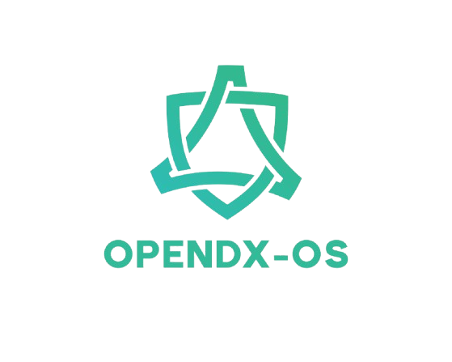
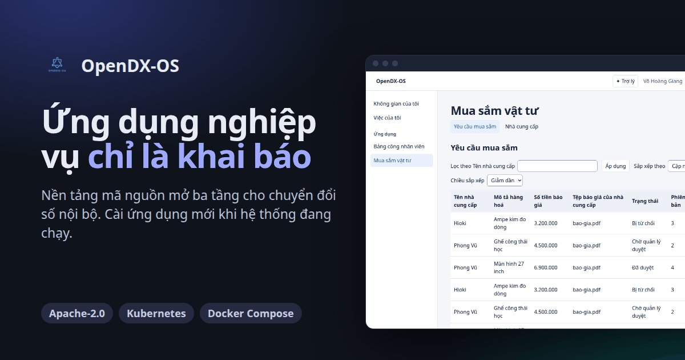
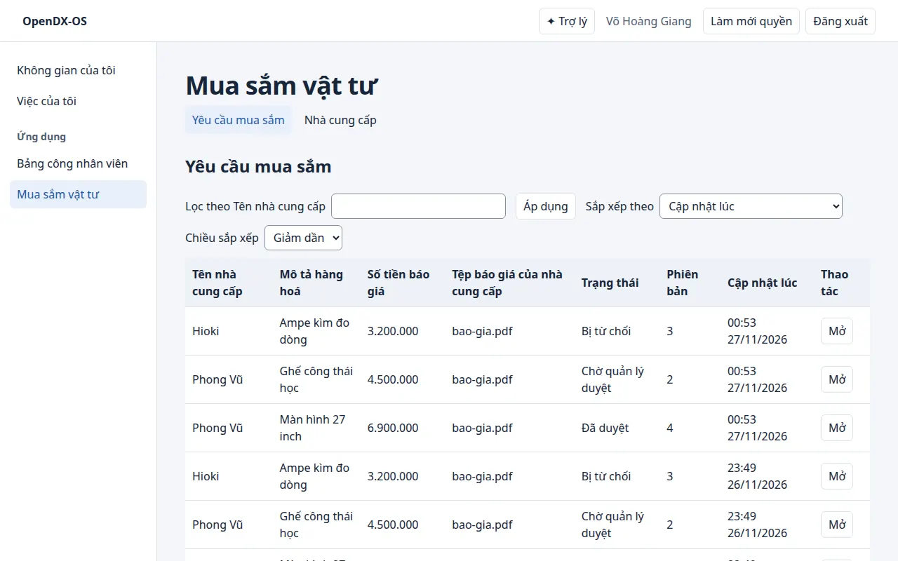
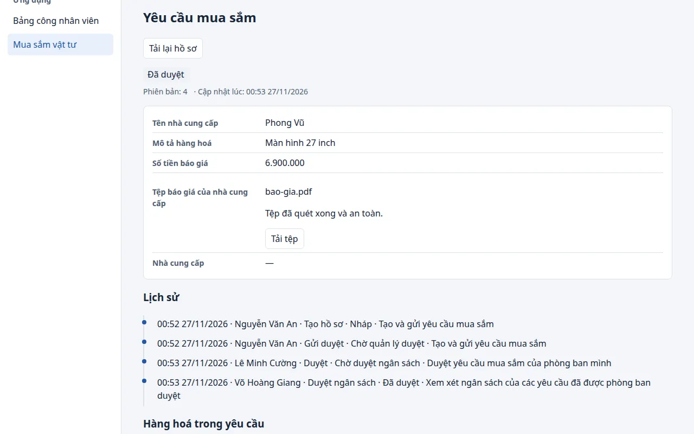
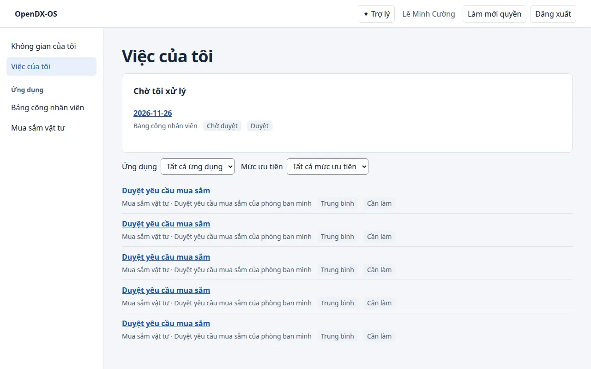
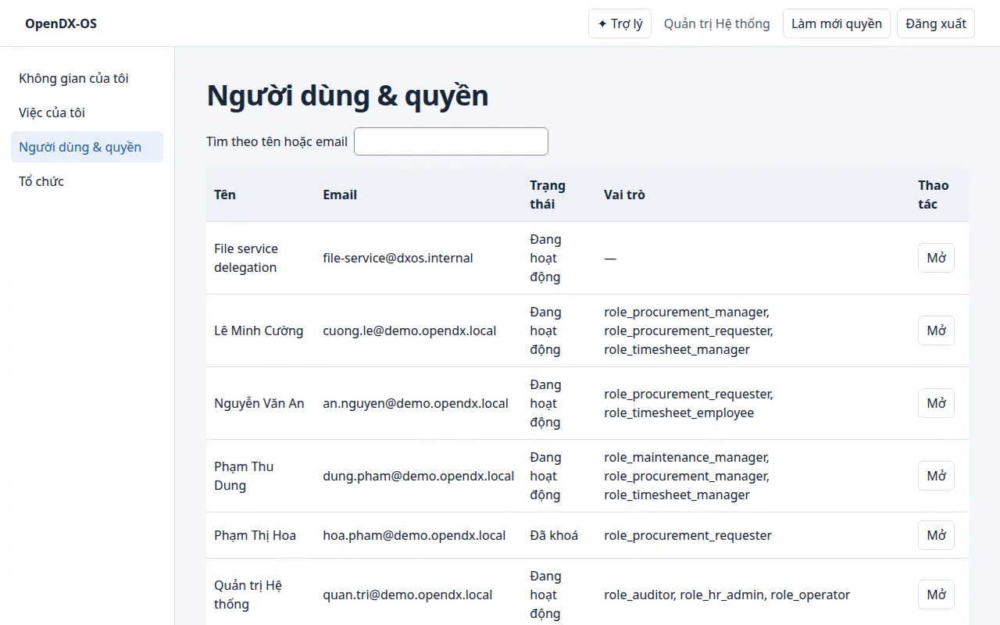

<div align="center">



### Một nền tảng số hoá cho mọi ứng dụng nội bộ

*Mỗi ứng dụng chỉ là một gói khai báo: dữ liệu, vai trò và quy trình duyệt.<br>
OpenDX-OS biến gói đó thành ứng dụng hoàn chỉnh và cài được ngay khi hệ thống đang chạy.*

[](LICENSE)
[](https://github.com/nguyentin05/opendx-os/actions/workflows/ci.yml)
[](https://github.com/nguyentin05/opendx-os/releases)
[](operator/go.mod)
[](https://nguyentin05.github.io/opendx-os/get-started/)
[](https://discord.gg/Mt7zskvcpU)

**Tiếng Việt** | [English](README.en.md)

[Trang chủ](https://nguyentin05.github.io/opendx-os/) ·
[Tài liệu](https://nguyentin05.github.io/opendx-os/get-started/) ·
[Chạy nhanh](#chạy-nhanh) ·
[Lộ trình](ROADMAP.md) ·
[Đóng góp](CONTRIBUTING.md)

</div>

> **Tóm tắt:** **OpenDX-OS** là nền tảng mã nguồn mở, tự vận hành, giúp tổ chức đưa các quy trình nội bộ như mua sắm, bảo trì thiết bị hay chấm công lên cùng một hệ thống. Đăng nhập, phân quyền, lưu trữ, luồng duyệt và giao diện do nền tảng lo; mỗi ứng dụng chỉ khai báo phần nghiệp vụ trong một `manifest.yaml`. Cùng một bộ cấu hình chạy bằng **Docker Compose** trên một máy hoặc trên **Kubernetes** (EKS, GKE, AKS, máy chủ riêng). Phát triển cho kỳ thi **OLP Phần mềm nguồn mở 2026**.

<div align="center">

</div>

---

## OpenDX-OS là gì?

Mỗi quy trình nội bộ thường kéo theo một phần mềm riêng, nên tài khoản, phân quyền và dữ liệu nằm rải rác, khó biết ai được làm gì và đã làm gì. OpenDX-OS gom những phần mọi ứng dụng đều cần vào một nền tảng dùng chung. Tổ chức mô tả mỗi quy trình bằng một gói khai báo: các bảng dữ liệu, vai trò, cột mỗi vai trò được xem, các trạng thái và lệnh chuyển trạng thái. Operator đọc gói đó, tạo bảng, quyền, luồng duyệt và vai trò, rồi cổng làm việc tự dựng danh sách, biểu mẫu và trang chi tiết đúng theo vai trò của từng người.

---

## Tính năng chính

### Ứng dụng là khai báo
- **Cài khi hệ thống đang chạy:** chép một gói vào `apps/` (Compose) hoặc `kubectl apply` một `DXApplication` (Kubernetes); ứng dụng sẵn sàng sau dưới 30 giây, không build, không triển khai lại.
- **Máy trạng thái có kiểm soát:** mỗi lệnh khai báo trạng thái nguồn, trạng thái đích, vai trò được phép và bộ lọc bản ghi, ví dụ trưởng phòng không tự duyệt yêu cầu của mình.
- **Tự sửa lệch cấu hình:** controller so cấu hình thật với gói khai báo và khôi phục quyền hoặc metadata bị sửa tay.

### Nền tảng dùng chung (Tầng 1)
- **Một lần đăng nhập, một nơi cấp quyền:** Keycloak xác thực; `dxos-authz` kiểm quyền từng yêu cầu theo vai trò và phòng ban, thu quyền có hiệu lực gần như ngay lập tức.
- **Dữ liệu có lịch sử đầy đủ:** PostgreSQL với kiểm tra phiên bản cho mỗi lệnh, nên lệnh dựa trên phiên bản cũ bị từ chối thay vì ghi đè; mỗi bước ghi rõ ai làm, lúc nào, với vai trò gì.
- **API qua một cổng:** APISIX đứng trước Hasura (GraphQL, có cập nhật trực tiếp) và các dịch vụ; Kestra chạy luồng duyệt; SeaweedFS lưu tệp và ClamAV quét virus trước khi cho tải.

### Năng lực dùng chung H-P-D-I (Tầng 2)
- **Nhân sự (H):** phòng ban, nhân viên, quyết định ai thấy dữ liệu nào.
- **Quy trình (P):** lệnh, tệp đính kèm, lịch sử và Việc của tôi cho từng người.
- **Dữ liệu (D):** số liệu từ thiết bị (đang hoàn thiện, xem [lộ trình](ROADMAP.md)).
- **Trí tuệ (I):** Trợ lý trả lời từ tài liệu của tổ chức, kèm trích dẫn, và thư viện cá nhân.

### Vận hành
- **Compose và Kubernetes luôn khớp nhau:** một bộ cấu hình, được kiểm tra tự động để hai cách triển khai không lệch.
- **Tự tắt khi rảnh:** trên Kubernetes, KEDA cho dịch vụ quy trình về 0 khi không có việc và bật lại ngay khi có yêu cầu.
- **Quan sát được:** traces, metrics và logs theo chuẩn OpenTelemetry.
- **Bảo mật từ đầu:** secret sinh riêng lúc cài đặt; mỗi thay đổi được quét bằng gitleaks, Trivy và CodeQL; image có attestation.

---

## Ảnh chụp

| Danh sách theo vai trò | Hồ sơ và lịch sử |
| :---: | :---: |
|  |  |
| **Việc của tôi** | **Người dùng và quyền** |
|  |  |

---

## Kiến trúc ba tầng

| Tầng | Vai trò | Thành phần |
| :--- | :--- | :--- |
| **3 · Ứng dụng** | Gói khai báo, cài và gỡ khi hệ thống đang chạy | Mua sắm vật tư, Bảo trì thiết bị, Bảng công nhân viên |
| **2 · Năng lực dùng chung** | Viết một lần, ứng dụng nào cũng dùng | `cap-hr`, `cap-process`, `cap-ai`, Việc của tôi, Workspace UI |
| **1 · Nền tảng lõi** | Không có giao diện, chỉ cung cấp API; mọi yêu cầu đều được kiểm quyền | PostgreSQL, Hasura, Keycloak, `dxos-authz`, APISIX, Kestra, SeaweedFS, ClamAV |

Chi tiết ở [kiến trúc](docs/architecture/index.md) và các [ADR](docs/adr/index.md).

---

## Nền tảng triển khai

| Nền tảng | Cách triển khai | Ghi chú |
| :--- | :--- | :--- |
| **Một máy** | Docker Compose | Dùng thử và phát triển; mặc định chỉ mở cổng trên 127.0.0.1 |
| **Amazon EKS** | Kustomize overlay `deploy/k8s/overlays/eks` | Có cụm demo chạy thật |
| **Google GKE** | `deploy/k8s/overlays/gke` | Cấu hình mẫu |
| **Azure AKS** | `deploy/k8s/overlays/aks` | Cấu hình mẫu |
| **Máy chủ riêng** | `deploy/k8s/overlays/onprem` | Cụm Kubernetes tự quản |

Xem [cài đặt](docs/operations/installation.md) và [Kubernetes](docs/operations/kubernetes.md).

---

## Chạy nhanh

### Yêu cầu
- Docker với Docker Compose v2
- Git; Python 3 cho các script tiện ích

### Khởi động
```bash
git clone https://github.com/nguyentin05/opendx-os.git
cd opendx-os
scripts/init-env.sh          # tạo .env với secret ngẫu nhiên (không bắt buộc khi chạy trên máy)
docker compose up -d --build
scripts/test-compose.sh      # đợi từng dịch vụ sẵn sàng và kiểm tra nó phản hồi
```

### Dữ liệu demo
```bash
scripts/seed-demo.py seed    # tài khoản, phòng ban và vai trò demo
scripts/seed-demo.py scopes  # mỗi người demo nhìn thấy những gì
scripts/seed-demo.py flow    # đưa một đề nghị mua sắm qua toàn bộ chuỗi duyệt
```

Mở <http://localhost:5173> và đăng nhập bằng một tài khoản demo, ví dụ `an.nguyen` (người đề nghị), `cuong.le` (trưởng phòng) hoặc `giang.vo` (tài chính); mật khẩu là `DEMO_PASSWORD` (mặc định `Demo@2026`). Xem [luồng đầu tiên](docs/get-started/first-request.md).

Khi không có `.env`, Compose dùng giá trị mặc định cho môi trường phát triển. Hãy chạy `scripts/init-env.sh` trước khi đặt `BIND_ADDRESS` để mở stack ra ngoài. Role và mật khẩu cơ sở dữ liệu được đặt khi volume dữ liệu khởi tạo lần đầu, nên sau khi đổi chúng cần chạy `docker compose down -v`. Dịch vụ `operator` cài mọi gói trong `apps/`; chép một gói vào hoặc xoá nó đi thì lượt chạy kế tiếp (mỗi 30 giây) sẽ cài hoặc gỡ gói đó.

---

## Phát triển và kiểm tra

Cần Python 3 (bộ test Python cần thêm PyYAML), Go theo [operator/go.mod](operator/go.mod) và [capabilities/go.mod](capabilities/go.mod), Node/npm cho [Workspace UI](workspace-ui/package.json).

```bash
make check                                  # kiểm tra repository
python3 -m unittest discover -s tests -v    # bộ test Python
make test                                   # thêm test Go, test và build giao diện
```

| Thư mục | Nội dung |
| :--- | :--- |
| `platform/`, `operator/` | Hạ tầng dùng chung và control plane viết bằng Go |
| `capabilities/`, `workspace-ui/` | Dịch vụ H-P-D-I và App Shell React/TypeScript |
| `apps/` | Các gói ứng dụng mẫu |
| `deploy/` | Manifest Kubernetes và overlay cho từng nền tảng |

Xem [kiểm chứng](docs/contribute/verification.md) để biết lệnh cho từng module và giới hạn của độ bao phủ.

---

## Tài liệu

- **[Bắt đầu](https://nguyentin05.github.io/opendx-os/get-started/):** cài đặt và chạy luồng đầu tiên.
- **[Kiến trúc](docs/architecture/index.md):** ba tầng, mô hình bảo mật và [ADR](docs/adr/index.md).
- **[Hợp đồng dữ liệu và manifest](docs/reference/data-contracts/index.md):** khai báo được gì và nền tảng đảm bảo gì.
- **[Thêm một ứng dụng](docs/guides/adding-an-app.md):** từ manifest tới giao diện.
- **[Vận hành](docs/operations/index.md):** cài đặt, Kubernetes, sao lưu và giám sát.
- **[Bảo mật và nghiệm thu](docs/reference/security/index.md)** và **[báo cáo lỗ hổng](SECURITY.md)**.

---

## Cộng đồng và đóng góp

- **Hỏi đáp và thảo luận:** [Discord](https://discord.gg/Mt7zskvcpU).
- **Báo lỗi và đề xuất:** [GitHub Issues](https://github.com/nguyentin05/opendx-os/issues).
- **Đóng góp:** đọc [hướng dẫn đóng góp](CONTRIBUTING.md) và [bộ quy tắc ứng xử](CODE_OF_CONDUCT.md).
- **Lỗ hổng bảo mật:** báo riêng theo [chính sách bảo mật](SECURITY.md), không mở issue công khai.

---

## Giấy phép

Code gốc của dự án được cấp phép theo [Apache-2.0](LICENSE). Xem [NOTICE](NOTICE), [COPYRIGHT.txt](COPYRIGHT.txt) và [THIRD_PARTY_LICENSES.txt](THIRD_PARTY_LICENSES.txt) để biết thông tin ghi công và giấy phép của bên thứ ba.
