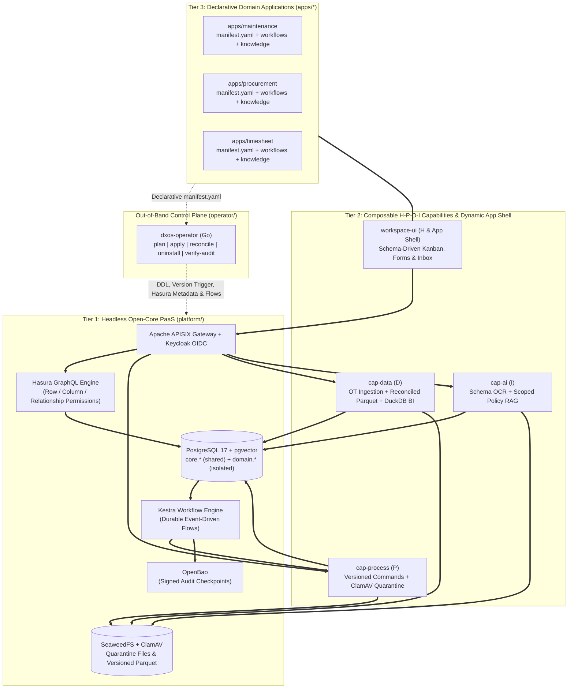

# OpenDX-OS System Architecture Overview

This directory contains the architectural documentation for **OpenDX-OS (DX-OS Open-Core)**.

---

## 1. Three-Tier Composable Architecture

---

## 2. Architecture Decision Records (ADRs)

- [ADR 0001: Three-Tier Composable Architecture with Shared Core and Isolated Domain Tables](../adr/0001-three-tier-composable-architecture.md)
- [ADR 0002: Core Schema Purity and Semantic Cross-App Data Synchronization](../adr/0002-semantic-schema-governance-and-cross-app-data-sync.md)
- [ADR 0003: Separation of Core Kernel Schema and Pluggable Capability Data Schemas (cap-data)](../adr/0003-modular-capability-schema-separation-for-iot-data.md)

---

## 3. Key References

- **Architecture Contract:** [`../../.agents/memory/architecture.md`](../../.agents/memory/architecture.md)
- **Data & Manifest Contract:** [`../../.agents/memory/data-contracts.md`](../../.agents/memory/data-contracts.md)
- **Security & Acceptance Scenarios (`S01`–`S08`):** [`../../.agents/rules/03-anti-patterns-and-security.md`](../../.agents/rules/03-anti-patterns-and-security.md)
