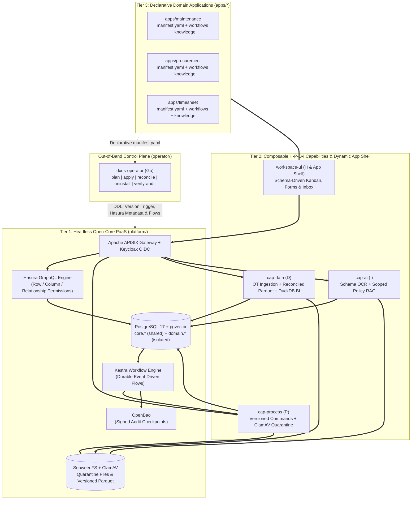

# OpenDX-OS System Architecture Overview

This document defines the intended architecture of **OpenDX-OS (DX-OS Open-Core)**.
The checkout contains partial implementations; this inventory and diagram do not
establish that every component is installed, connected, or verified.

## Architecture boundaries

- Tier 1 provides shared infrastructure in `platform/`. The Go `operator/` is
  the control plane outside the synchronous request path; running apps continue
  serving when it stops.
- Tier 2 provides reusable H-P-D-I capabilities in `capabilities/` and the
  registry/schema-driven App Shell in `workspace-ui/`.
- Tier 3 packages domain declarations in `apps/<app>/manifest.yaml`,
  `workflows/*.yaml`, and `knowledge/*.md`; there is no per-app backend.
- Adding an app using supported capabilities changes its package and published
  configuration. A new capability may require Tier 2 extensions with an explicit
  contract change.
- Shared runtime code, configuration, and bootstrap DDL consume manifest
  identifiers rather than branching on app names. Domain names in examples,
  fixtures, and tests must not become a runtime app list.
- The Operator generates domain-table DDL from manifests. Bootstrap creates
  shared structures and enabled capability storage. OT publishes standard events;
  declared app workflows supply thresholds and business responses.

## Components and responsibilities

| Area | Intended responsibility |
| --- | --- |
| Keycloak and APISIX | OIDC SSO/MFA, token validation, routing, and rate limits |
| PostgreSQL, pgvector, and Hasura | Transactional data and filtered CRUD/subscriptions by workspace, role, and column |
| Kestra | Declarative workflows fed by durable, retryable events |
| SeaweedFS and ClamAV | Objects, Parquet, quarantine, and scanning |
| OpenBao | Signed audit checkpoints outside PostgreSQL |
| `dxos-operator` | Manifest lifecycle, DDL, Hasura metadata, roles, routes, flows, and registry publication |
| `cap-process` (P) | Commands, business validation, and file lifecycle |
| `cap-data` (D) | OT validation/deduplication, reconciled export, DuckDB BI, and lineage |
| `cap-ai` (I) | Schema-driven OCR and scoped RAG with source citations |
| `workspace-ui` (H and App Shell) | Registry-driven navigation, Kanban/Calendar, forms, inbox, OT/BI, and OCR/RAG |

Dependency manifests and deployment configuration record actual technology versions.

## Control plane and runtime

The intended Operator interface includes `plan`, `apply`, `reconcile`, `uninstall`,
and `verify-audit`. `plan` has no side effects. Configuration progresses through
`Pending -> Applying -> Ready | Failed`, with manifest versions and structured
errors. Publish only ready configuration; a failed update must keep desired and
active state distinguishable. Runtime consumers read published configuration
without calling the Operator for each request. Check the actual CLI before use;
the command set is not fully implemented.

On Kubernetes, `dxos-operator controller` reconciles cluster-scoped
`DXApplication` resources with the same planner and applier as the CLI and
reports progress in status conditions; see
[installation](../operations/installation.md#kubernetes-operator-development-cluster).

Reconcile adds missing and revokes excess configuration within managed resources
and roles, using the active manifest set. Multiple apps sharing `core.*` require
combined valid permissions; reconciling one app must not remove another's grants.

Global resources (domain tables, triggers, Hasura metadata) are planned from the
active definitions in `core.app_definitions`, never from one workspace's
registry. Unpublishing an app from one workspace keeps its grants while another
workspace still publishes it; an upgraded definition is republished in every
workspace that uses it.

Before applying, the Operator compares each live domain table with its manifest.
Adding a nullable column is converged automatically; a type or nullability
change, a new required column, or an undeclared live column blocks publication
with a structured error while the previous version keeps serving. CHECK
constraints are not compared yet.

Each capability provides health and registry metadata. Disabled or unavailable
capabilities make dependent features unavailable with a reason, while independent
features continue working. The backend also checks availability and permissions.

Uninstall revokes an app's permissions, routes, flows, and registrations. Deleting
domain data is separate and requires an explicit retention policy and authorized
scope. Likewise, disabling optional storage does not imply dropping tables.

## Decisions and contract changes

The [ADRs below](#2-architecture-decision-records-adrs) record accepted decisions
and rationale; this document and the [data contract](../contracts/data-contracts.md)
describe their current application. ADR 0002 refines domain-attribute ownership;
ADR 0003 refines optional capability storage while retaining the three tiers.
ADR 0004 (proposed) separates global definitions from per-workspace publication
and introduces the `DXApplication` CRD controller.

For a proposed change, identify relevant accepted decisions and affected contracts,
producers, consumers, examples, and data migrations. Record a replacement decision
in an ADR with explicit supersession when changing an accepted decision. Update
the current contracts and affected consumers within scope; record pending work
when implementation is separate. A newer date or divergent code alone does not
override an accepted requirement. Name conflicting sources and resolve them
against the agreed requirement; ask only when a product/architecture choice is
still unassigned.

## Architecture verification

Verify plugging an app beyond the three examples without core edits, runtime
operation while the Operator is stopped, capability disablement, and reconcile
across apps sharing resources. Check for circular dependencies and domain logic
leaking into shared code. Report a finding's location, failure scenario, impact,
and fix direction using the [verification guidance](../development/verification.md).

---

## 1. Three-Tier Composable Architecture

---

## 2. Architecture Decision Records (ADRs)

[ADR 0005](../adr/0005-department-and-application-data-model.md) records the accepted
one-organization target with independent application and department identity.
Workspace-oriented descriptions in this document and current contracts are legacy/partial
implementation context pending coordinated follow-up; they do not override ADR 0005.

- [ADR 0001: Three-Tier Composable Architecture with Shared Core and Isolated Domain Tables](../adr/0001-three-tier-composable-architecture.md)
- [ADR 0002: Core Schema Purity and Semantic Cross-App Data Synchronization](../adr/0002-semantic-schema-governance-and-cross-app-data-sync.md)
- [ADR 0003: Separation of Core Kernel Schema and Pluggable Capability Data Schemas (cap-data)](../adr/0003-modular-capability-schema-separation-for-iot-data.md)
- [ADR 0004: Kubernetes CRD Operator with a Cluster-Scoped Application Definition](../adr/0004-kubernetes-crd-operator.md) (proposed)
- [ADR 0005: Department and application data model](../adr/0005-department-and-application-data-model.md) (accepted; runtime alignment pending)

---

## 3. Key References

- [Data and manifest contract](../contracts/data-contracts.md)
- [Security and acceptance scenarios S01–S08](../contracts/security-and-acceptance.md)
- [Design mistakes to recognize](anti-patterns.md)
