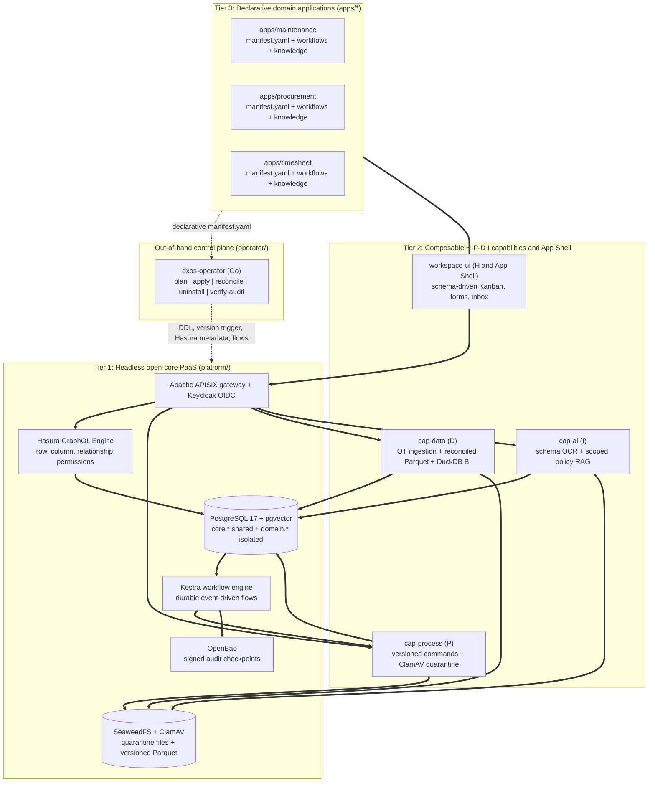

# Three tiers

OpenDX-OS separates shared infrastructure, reusable capabilities, and declared
applications. A change should land in the lowest tier that can own it.

## Tier 1: shared infrastructure

Tier 1 is the headless platform. It provides the database, authentication,
gateway, workflow engine, object storage, scanning, and audit anchoring. Tier 1
never references Tier 2 or Tier 3 tables.

## Tier 2: capabilities and App Shell

Tier 2 provides reusable H-P-D-I services:

| Capability | Responsibility |
| --- | --- |
| `cap-hr` (H) | Departments and staff: who works where, which the `department` scope reads |
| `cap-process` (P) | Commands, business validation, and file lifecycle |
| `cap-data` (D) | OT validation/deduplication, reconciled export, DuckDB BI, and lineage |
| `cap-ai` (I) | Schema-driven OCR and scoped RAG with source citations |
| `workspace-ui` | Registry-driven navigation, Kanban/Calendar, forms, inbox, OT/BI, and OCR/RAG |

Capabilities own their schemas, register themselves in `core.capabilities`, and
are enabled per installation. Disabling a capability does not delete its stored
data.

## Tier 3: application packages

A Tier 3 package declares:

- `manifest.yaml`: capabilities, roles, shared access, domain tables, workflows,
  and optional knowledge sources;
- `workflows/*.yaml`: Kestra flows limited to declared, reviewable task types;
- `knowledge/*`: optional versioned knowledge sources.

The Operator installs packages out of band. Runtime services read published
configuration and never call the Operator per request.
