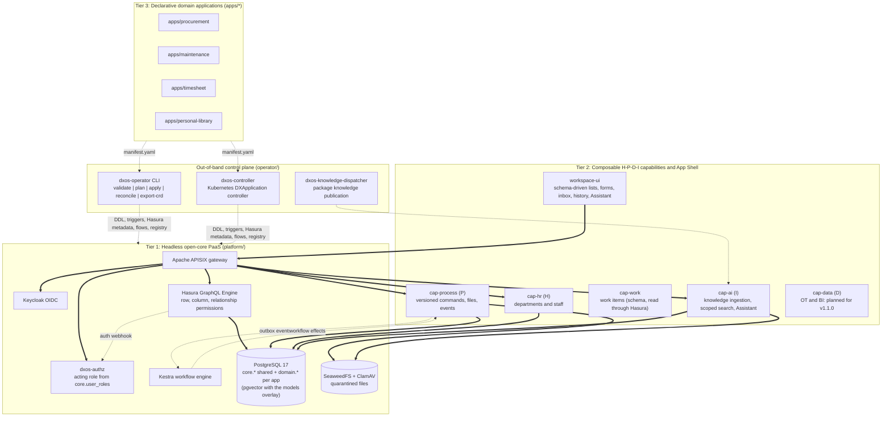

# Three tiers

OpenDX-OS separates shared infrastructure, reusable capabilities, and declared
applications. A change should land in the lowest tier that can own it.

## Tier 1: shared infrastructure

Tier 1 is the headless platform. It provides the database, authentication
(Keycloak) and authorization (`dxos-authz`), the gateway, the workflow engine,
object storage and scanning. Tier 1 never references Tier 2 or Tier 3 tables.
Anchoring audit checkpoints outside PostgreSQL is a requirement that is not
implemented yet ([audit](../reference/data-contracts/writes-and-versions.md#version-command-audit-and-retry)).

## Tier 2: capabilities and App Shell

Tier 2 provides reusable H-P-D-I services:

| Capability | Responsibility | Status |
| --- | --- | --- |
| `cap-hr` (H) | Departments and staff: who works where, which the `department` scope reads | Service and schema |
| `cap-process` (P) | Commands, business validation, file upload and scanning, record history, and event delivery to workflows | Service and schema |
| `cap-work` | Work items opened and closed by workflow effects, read through Hasura | Schema only; a cap-work service and a Kanban board are planned (#27, #44) |
| `cap-data` (D) | OT validation and deduplication, reconciled export, BI, and lineage | Schema only; the service moves to the `cap_data` schema in v1.1.0 (#111) |
| `cap-ai` (I) | Knowledge ingestion of Markdown and text PDFs, role-scoped search with citations, the personal library and the Assistant | Service, parser and worker in the `compose.rag.yaml` overlay; scanned PDFs need OCR, which is not available |
| `cap-ai-model-adapter` | Boundary integration for hosted inference: one reviewed `bounded-http-v1` request becomes one OpenAI-compatible upstream call | Opt-in `compose.model-adapter.yaml` overlay; no database, identity or policy; private TLS only |
| `workspace-ui` | Registry-driven navigation, lists, forms, record detail with commands and history, inbox, My Work, knowledge pages, and the Assistant | Implemented; Kanban, Calendar and OT/BI views are not |

Capabilities own their schemas, register themselves in `core.capabilities`, and
are enabled per installation. Disabling a capability does not delete its stored
data.

The model adapter is a Tier 2 boundary integration, not a capability with its own
schema: it holds no database connection, no application identity and no policy or
approval decision. It translates one already-authorized bounded request into one
reviewed upstream call over a private TLS listener, with no published host port and
no APISIX route, and it never selects a model, changes a provider or retries an
ambiguously sent call. The
[Model Gateway](../reference/rag/api.md#model-gateway) remains the sole production
dispatch authority, and the database registry remains the sole active-model
authority. Its opt-in overlay is documented in
[model answers](../guides/knowledge/models.md#bundled-hosted-adapter-opt-in).

## Tier 3: application packages

A Tier 3 package declares:

- `manifest.yaml`: capabilities, roles, shared access, domain tables, workflows,
  and optional knowledge sources;
- `workflows/*.yaml`: Kestra flows limited to declared, reviewable task types;
- `knowledge/*`: optional versioned knowledge sources.

The Operator installs packages out of band. Runtime services read published
configuration and never call the Operator per request.
