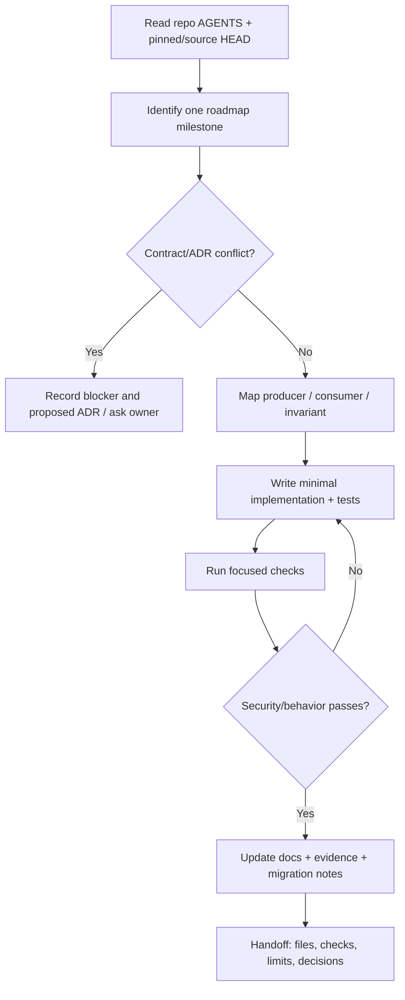

# Instructions for a Coding Agent — OpenDX-OS Native RAG

> This file is a **task guide**, not a replacement for the repository's `AGENTS.md`, accepted ADRs, or the user's direct instructions.

## Mission and immutable boundaries

Design and incrementally implement the Intelligence (I) capability for OpenDX-OS using the accompanying docs. Preserve the three-tier architecture:

- **Tier 1:** shared identity, gateway, database, file storage/scanning, secrets and audit mechanisms.
- **Tier 2:** `cap-ai` owns knowledge metadata, document ACL, ingestion orchestration, retrieval and LLM Gateway adapters.
- **Tier 3:** domain applications only declare package knowledge, document binding, intended roles and UI features. They do not create their own AI backends.
- **Operator:** out-of-band control plane; never a synchronous dependency of user requests.

Do not merge capability tables into `core` for convenience. Do not grant model agents direct access to PostgreSQL, the original file store, or API secrets. Never let an LLM or client-supplied roles decide authorization.

## Read-before-code checklist

1. Confirm current repo, branch, **HEAD SHA** and working-tree status; do not assume the 2026-11-13 baseline is still current.
2. Read `AGENTS.md` first, then relevant `docs/architecture/README.md`, accepted ADRs, `docs/contracts/data-contracts.md`, `docs/contracts/security-and-acceptance.md`, and relevant capability/Operator skills.
3. Read actual SQL, Go handlers and manifest types. The pinned snapshot includes contradictory models:
   - SQL `core.files / core.apps / core.roles / core.user_roles` and one organization per installation.
   - Some accepted ADRs/contracts, sample app manifests and File Service still use `workspace_id / core.file_objects`.
   - `cap_ai.sql` only registers a capability. It **does not** define document tables or a native RAG pipeline.
   - The current Operator CLI includes `apply`; old explanatory docs may say otherwise. Inspect actual implementation and tests before citing lifecycle behavior.
4. Read the task-specific design page and its **PROPOSED** sections.
5. Before changing shared contracts, name all producers and consumers and find the current serialization and tests.

## Decision gate — stop before structural changes

**Do not silently select either organization model.** An accepted ADR and consistent contracts must resolve the conflict before migrations, FK design or identity-scoped APIs depend on it.

Required decisions to record explicitly:

- One organization per installation vs multi-workspace data partitioning.
- Personal documents spanning apps: dedicated personal app namespace, a changed `core.files` contract, or a separately governed source type.
- Exact extension to `DXApplication` for knowledge sources and their security declarations.
- Service-to-service authorization/effective-role trust, document visibility inheritance, and restricted-data external model egress.

You may work on independent interfaces, unit tests, mock components or design while blocked. Do not implement irreversible DDL or a privilege-expanding workaround to evade the gate.

## Iterative delivery loop



### Per-task instructions

For each task, create a short plan:

- **Scope:** one milestone and changed components.
- **Preconditions:** approved ADR/contract decisions; current API and DDL truth.
- **Invariants:** identity is trusted; `deny-by-default`; source file must be `CLEAN`; document/linked record must be readable; no model secrets leak.
- **Implementation:** schema/versioning, service interfaces, tests, documentation.
- **Verification:** unit + relevant integration tests; explicitly distinguish PASS/FAIL/NOT_RUN.
- **Rollback:** previous app source version remains active; no data loss on worker/Operator failures.

### Verification examples (confirm prerequisites in repository first)

```bash
make check-hygiene
python3 -m unittest discover -s tests -v
(cd capabilities && go test ./...)
(cd operator && go test ./...)
```

Real PostgreSQL/Hasura, Keycloak, SeaweedFS and inference tests require separate configured environments; do not report them PASS based on static checks alone.

## Operational non-negotiables

1. Authenticate a real actor; derive allowed role set and selected role from trusted identity/session, not request JSON.
2. Use stable document/source IDs, immutable versions, checksums, idempotent jobs and atomic active-version publish.
3. Re-evaluate authorization on search, retrieval, source preview/download and agent tool invocations; invalidate/reject stale cache on revoke.
4. Keep strict separation: **user-supplied documents are untrusted text**, never system instructions or tool calls.
5. Central API keys belong to product operations; no user/organization BYOK UI. Enforce quotas, spending ceilings and allowed providers.
6. No direct visibility of PRIVATE docs merely because a caller is a platform operator or `role_hr`.
7. No per-app special cases in shared RAG handlers. App IDs/roles/policies must be declarative and validated.
8. Avoid replacing the whole existing platform with an unrelated RAG monolith or autonomous super-agent.

## Suggested implementation order

1. Resolve identity/org/file contracts.
2. Create `cap_ai` schema and policy service.
3. Reconcile File Service and secure runtime upload.
4. Add immutable ingestion jobs + DocIR/parser adapters.
5. Integrate package knowledge via Operator.
6. Add product-funded Model Gateway + usage/quotas; route embeddings through it.
7. Add guarded retrieval + citations + answer generation.
8. Connect workspace UI.
9. Enable future Agent Harness as a constrained caller, only when RAG governance is proven.

See [implementation roadmap](docs/09-implementation-roadmap.md) for detailed milestones, dependencies and acceptance evidence.

## Required final message after each implementation task

```text
Scope and pinned HEAD:
Decision/ADR status:
Implemented vs still proposed:
Changed files:
Security invariants preserved:
Checks with PASS / FAIL / NOT_RUN and evidence:
Known gaps and deferred tasks:
Rollback/migration notes:
```

Do not claim migrations, integration tests, model quality or permission enforcement work until verified in a running environment.
