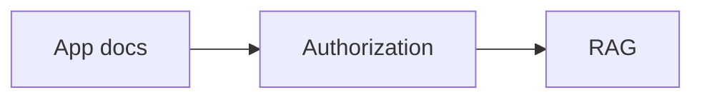

# Mermaid Diagram Index — Visual Reading Order

All diagrams are **editable Mermaid code blocks embedded in Markdown**. They are intended for GitHub rendering and agent ingestion. There are **28 Mermaid diagrams** in this package.

| File | Diagram(s) | What to inspect |
|---|---|---|
| [README](README.md) | End-to-end topology | App/Operator/runtime/Tier 1–2 flow |
| [AGENT_GUIDE](AGENT_GUIDE.md) | Agent task loop | Contract gate, edit, verification, handoff |
| [01 Architecture](docs/01-system-architecture.md) | Three-tier deployment, Operator-to-runtime sequence, source dependencies | Ownership and control-plane separation |
| [02 Authorization](docs/02-identity-and-authorization.md) | Read decision tree, HR-specific ACL sequence, revocation | Private ownership and restricted HR logic |
| [03 Data Model](docs/03-data-model-and-lifecycle.md) | Conceptual ERD, document version state machine | Identity refs, versions, source provenance |
| [04 Ingestion](docs/04-ingestion-and-document-processing.md) | Two paths, runtime upload sequence, package sequence, DocIR parser flow, job state | PDF/MD/image/table ingestion and retries |
| [05 Secure RAG](docs/05-secure-retrieval-and-rag.md) | Query sequence, retrieval decision tree, prompt injection boundary | Pre-/post-authorization and citations |
| [06 Operator](docs/06-operator-and-app-integration.md) | Package vs runtime sources, Operator sequence, user document sequence | Declarative app knowledge and ownership |
| [07 LLM Gateway](docs/07-llm-gateway-and-cost.md) | Model topology, budget reservation sequence | Provider-funded API key/cost/egress |
| [08 API and Events](docs/08-proposed-api-and-event-contracts.md) | Durable ingestion job sequence | Idempotent events and publication |
| [09 Roadmap](docs/09-implementation-roadmap.md) | Dependency graph | Agent implementation milestones P0–P9 |
| [10 Tests](docs/10-testing-and-security.md) | Trust-boundary map, negative-ACL test flow | Security acceptance |
| [11 Sources and Decisions](docs/11-source-baseline-and-open-decisions.md) | ADR decision branch | Source conflicts and stop conditions |

## Suggested review sequence

1. System topology → source ownership → authorization.
2. Data model ERD → upload/package ingestion → DocIR.
3. Secure RAG query → external model gateway and quota.
4. API/events → milestone roadmap → negative security tests.
5. Re-read source conflicts before implementing shared identity or file schema changes.

## Mermaid viewing and editing

GitHub renders fenced blocks of type `mermaid` directly in Markdown:

````text

````

The snippets in this package are design diagrams, not executable specifications. When changing implementation, update the relevant document's diagram and accompanying invariants together. The local `scripts/validate_docs.py.txt` checks Markdown fences, relative links and Mermaid block presence, but is not a full Mermaid parser or browser renderer.
