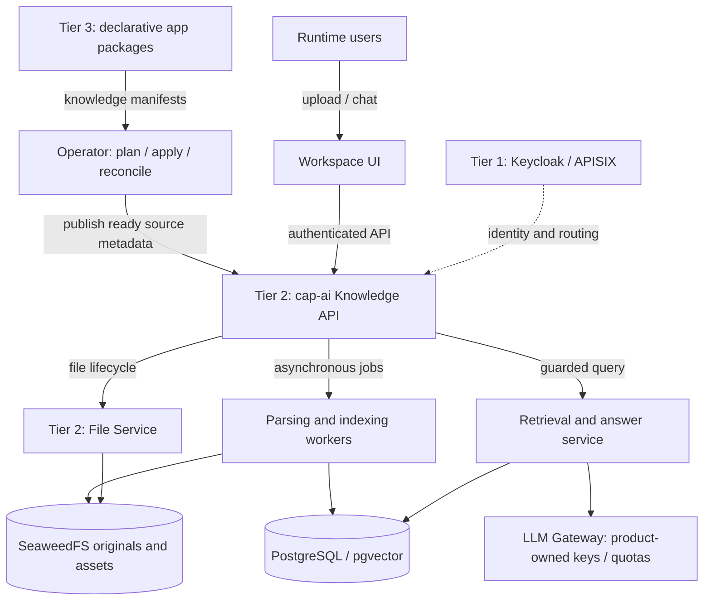

# OpenDX-OS — Native RAG Architecture & Agent Implementation Guide

**Documentation baseline:** 2026-11-13, branch `feat/db-org-model`, commit `23098cd324fc678dc321abf67d56b845f4aeb29b`.  
**Scope:** Native RAG for the Intelligence (I) capability, both Operator-registered app documents and runtime user uploads, secure document-scoped access, rich PDF/Markdown/image/table parsing, and centrally funded LLM usage.  
**Document status:** **PROPOSED DESIGN / IMPLEMENTATION HANDOFF**. This package does not implement migrations, APIs, or the Agent Harness.

> Start with [AGENT_GUIDE.md](AGENT_GUIDE.md) when assigning this material to a coding agent. Repository `AGENTS.md` and accepted ADRs/contracts remain authoritative. See [source/contract conflicts](docs/11-source-baseline-and-open-decisions.md).

## Locked product choices

1. **Build a native Knowledge/RAG capability** in Tier 2 (`cap-ai`), integrating existing Tier 1 components rather than deploying RAGFlow as a required runtime. Docling, Unstructured, RAGFlow, LlamaIndex, Haystack and pgvector are architectural/implementation references.
2. **Two knowledge sources:** Tier 3 app-packaged docs published through the Operator; runtime user/team documents uploaded through the platform File Service.
3. **Document-level authorization:** `PRIVATE`, `ROLE` and `RESTRICTED`. A sensitive HR document requires the HR role **AND** an explicit document grant; an ordinary HR role alone is insufficient. No new `core.permissions` table is required solely for these document ACLs.
4. **Original binaries and provenance:** OpenDX-OS owns original files and authoritative metadata. SeaweedFS holds blobs; PostgreSQL holds lifecycle, sources, versions, policies, elements and references; vector/FTS indexes are derived and revocable.
5. **Product provider pays all model costs:** OpenDX-OS operators configure centralized generation/embedding providers and credentials. Users and deployment organizations do **not** provide API keys in this MVP. The system enforces quotas, rate limits, egress policy and cost ledger.
6. **Future Agent Harness:** agent tools reuse the same authorized Knowledge API and LLM Gateway, never direct unguarded vector access.

## How to read this guide

| Order | File | Purpose | Mermaid focus |
|---|---|---|---|
| 0 | [AGENT_GUIDE.md](AGENT_GUIDE.md) | Coding-agent rules, required discovery, checkpoints, stop conditions | Delivery workflow |
| 1 | [01 — System architecture](docs/01-system-architecture.md) | Three-tier boundaries, ownership, control plane vs runtime | Topology and dependencies |
| 2 | [02 — Identity & authorization](docs/02-identity-and-authorization.md) | Roles, owner, ACL, source-file permission, anti-leak properties | Authorization decision, HR case |
| 3 | [03 — Data & versioning](docs/03-data-model-and-lifecycle.md) | `cap_ai` conceptual schema and foreign keys | ERD, lifecycle |
| 4 | [04 — Ingestion & rich documents](docs/04-ingestion-and-document-processing.md) | Two sources, scanning, DocIR, tables/images, jobs, reindex | Sequences, parse pipeline |
| 5 | [05 — Retrieval & answer generation](docs/05-secure-retrieval-and-rag.md) | Filtering, hybrid retrieval, rerank, context, citations | RAG sequence, failure gates |
| 6 | [06 — Operator & app integration](docs/06-operator-and-app-integration.md) | Proposed manifest extension, deployment, reconciling knowledge | Operator sequence |
| 7 | [07 — Models & cost](docs/07-llm-gateway-and-cost.md) | Provider-funded LLM, secrets, budgets and egress | Gateway and rate-limiter |
| 8 | [08 — APIs & events](docs/08-proposed-api-and-event-contracts.md) | Suggested REST/event contracts (not yet implemented) | API sequences |
| 9 | [09 — Implementation plan](docs/09-implementation-roadmap.md) | Dependencies, milestones, deliverables, agent handoff | Dependency flow |
| 10 | [10 — Security & acceptance tests](docs/10-testing-and-security.md) | Test matrix and negative cases | Threat boundary |
| 11 | [11 — Repo evidence & decisions](docs/11-source-baseline-and-open-decisions.md) | Verified files, documented contracts, conflicts, references | Decision branch |

**Visual index:** [Browse all 28 Mermaid diagrams](MERMAID_INDEX.md) grouped by architecture, security, ingestion, retrieval and operations.

`examples/knowledge-extension.proposed.yaml.txt` and `examples/document-policies.proposed.yaml.txt` are **DESIGN ONLY**. Current operator manifest parsing does not accept these fields; extend the contract before using them.

## System at a glance

### Legend used throughout

- **VERIFIED CODE:** directly observed in the pinned commit.
- **INTENDED CONTRACT:** stated in repository docs or accepted ADR, perhaps not implemented.
- **PROPOSED:** new design in this package; never describe as an existing API/schema.
- **BLOCKED DECISION:** conflicting authorities or a product choice that needs an explicit ADR/approval before coding.

### How to share with an agent

1. Extract the archive into the agent's working context or provide the directory.
2. Provide [AGENT_GUIDE.md](AGENT_GUIDE.md) as the first task document; instruct the agent to inspect the actual repository `AGENTS.md` and relevant files.
3. Request **one roadmap milestone at a time**. Do not ask the agent to implement the entire design in a single unreviewed change.
4. Require an evidence-backed handoff: modified paths, contract impacts, tests, and unresolved gates.

**This archive is self-contained Markdown; Mermaid code blocks render on recent GitHub Markdown viewers.**
