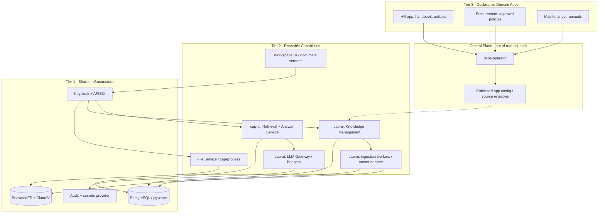
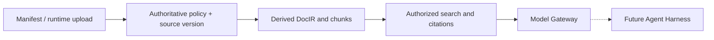

# 01 — System Architecture and Ownership

**Status:** architecture proposal grounded in the verified OpenDX-OS three-tier boundaries.  
**Primary question:** where does knowledge live, and who is allowed to operate on it?

## 1. Three-tier placement



### Ownership matrix

| Responsibility | Owner | Notes |
|---|---|---|
| Keycloak identity, JWT / role grants | Tier 1 / identity boundary | Do not accept selected roles from unverified clients. |
| App definitions and initial knowledge declarations | Tier 3 + Operator | Operator validates manifests; publishes metadata only when ready. |
| Runtime upload, scan, original file download | Shared File Service + storage | Never index or expose QUARANTINED / INFECTED sources. |
| `cap_ai` document policy / ACL / versions / chunks | Tier 2 Intelligence | Capability-specific data; not forced into kernel. |
| Document parsing / OCR / embedding indexing | Tier 2 async worker/adapter | Reuse Docling or another audited parser; custom DocIR. |
| Retrieval, citations, document search | Tier 2 Knowledge API | End-to-end source permissions, deny-by-default. |
| Provider API keys, quotas, usage/cost | Tier 2 Model Gateway + secret provider | Provider-funded, server-side only. |
| App UI and contextual search widgets | Workspace UI | UI never defines or expands access. |
| Future tool-use orchestration | Agent Harness in Tier 2 | Uses authorized APIs as tools, not raw indexes. |

**Schema is not a tier.** Multiple logical database schemas can live in one PostgreSQL instance: `core` for kernel, `cap_ai` for Intelligence, `domain` for app tables. Cross-schema FKs are technically supported, but must follow the agreed identity/org contract.

## 2. Control plane vs runtime

```mermaid
sequenceDiagram
    actor Dev as App maintainer
    participant OP as Operator
    participant DB as Published Config
    participant KI as Knowledge API
    participant Q as Ingestion Queue
    actor User
    Dev->>OP: Supply app package + knowledge manifest
    OP->>OP: Validate source paths / roles / version
    OP->>DB: Publish Ready config after successful apply
    OP-->>KI: Register intended immutable source revision
    KI->>Q: Enqueue indexing asynchronously
    Note over OP,User: Operator may stop; runtime continues with last Ready config
    User->>KI: Authenticated search
    KI->>DB: Read active documents + effective policy
    DB-->>KI: Allowed active versions only
    KI-->>User: Authorized results / citations
```

Operator **should not** perform OCR, embedding or live LLM calls during `plan`/`apply`. Slow ingestion is a retryable runtime job. Failing to index a new revision must not delete the last active knowledge snapshot. The exact Operator adapter is **PROPOSED**, not present today.

## 3. Key interfaces between components

- **Published config → Knowledge API:** immutable app/version/source declarations; no arbitrary code and no private key.
- **File API → Knowledge API:** `file_id`, scan result and authenticated principal/ownership; Knowledge verifies against authoritative File Service rather than trusting an event alone.
- **Worker → Knowledge metadata:** version-aware job state; idempotent updates; no cross-app access.
- **Knowledge Retrieval → Model Gateway:** authorized, bounded context; data classification/egress decision; central model profile.
- **Future Agent Harness → Knowledge API:** authenticated user-delegated scope, approved tools and token budgets.

## 4. Scope and risks



No direct dependency from Tier 3 to vector internals. Replacing `pgvector` or Docling should not change app manifests or permission policy. Consider a Go-hosted Knowledge API with a separate constrained Python parsing worker only if the chosen Docling/PDF libraries justify it; no language fork per app.

## 5. Decisions that gate production design

- Organization model conflicts with accepted workspace ADR/contracts. See `11`.
- Personal files currently conflict with app-bound `core.files.app_id NOT NULL` if cross-app ownership is required.
- A central capability-specific document ACL can work without kernel permission tables, but sharing authority and source-file read rights must be defined jointly with File Service.

Do not treat these gates as permission to bypass existing controls.
