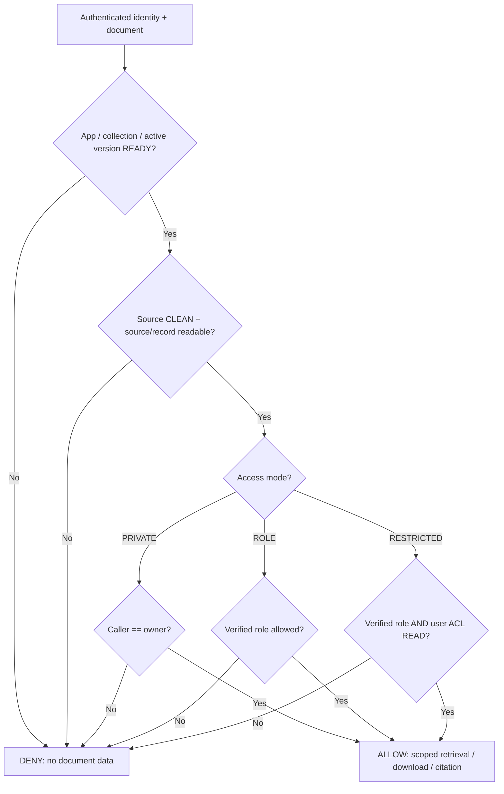
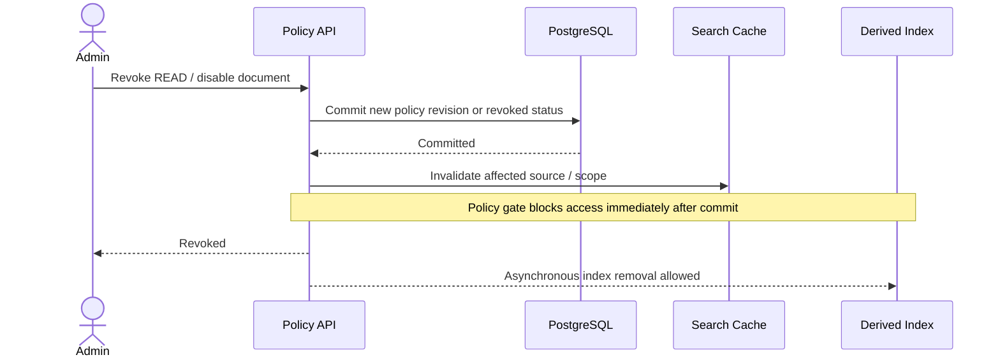

# 02 — Identity, Roles, Document ACL and Security Boundaries

**Objective:** User-private documents and selectively visible HR documents must remain confidential across UI, API, search, chunks, model context and citations.

## 1. What Core already provides

**VERIFIED CODE:** `core.users`, `core.roles` and `core.user_roles` exist in `platform/postgres/init/03_app_registry.sql`; roles may belong to the platform, an app or a capability. This is **RBAC membership**, not a general named `core.permissions` table. Code still contains workspace-era references elsewhere.

**PROPOSAL:** `cap_ai` owns **resource-scoped** grants (`document_acl`) and document policy, without bloating `core`. An ACL grants READ/MANAGE on one document; it is not the same as a platform-wide semantic permission such as `hr.payroll.read`. Cross-service semantic permissions require a separate accepted authorization contract.

### Access modes

| Mode | Actor can read if... | Typical case |
|---|---|---|
| `PRIVATE` | Actor is `owner_user_id`, and all mandatory app/file/record guards pass | Personal PDF or Markdown note |
| `ROLE` | Verified acting role is in `document_policies.allowed_roles`, and all guards pass | General HR handbook |
| `RESTRICTED` | Verified role passes **AND** caller has an explicit document `READ` grant; all guards also pass | Payroll records for selected HR specialists |

For documents tied to a domain record (e.g. quote attachment), **source-record read rights are an additional intersection**, never an alternative grant. Platform operator, account admin or model administrator does **not** automatically bypass PRIVATE or RESTRICTED.

## 2. Identity and decision function

Conceptual rule (not executable SQL):

```text
allow(document, actor, operation) =
  trusted_authenticated_actor(actor)
  AND app_is_ready_and_enabled(document.app_id)
  AND collection_is_visible_and_active(document.collection_id)
  AND active_document_version_is_ready_and_not_revoked(document)
  AND source_file_is_clean_and_readable(actor, document.source)
  AND linked_domain_record_is_readable_if_any(actor, document)
  AND (
    (PRIVATE    AND actor.user_id = document.owner_user_id)
    OR (ROLE       AND actor.acting_role IN allowed_roles)
    OR (RESTRICTED AND actor.acting_role IN allowed_roles
                   AND explicit_acl_grant(actor.user_id, document.id, READ))
  )
```

Never accept `actor.user_id`, `roles`, `app_id` or `workspace_id` from an unverified request body as authority. Verify effective role is among authenticated role grants. Scope `file_id` and record bindings to trusted app context.



## 3. HR example: role alone is insufficient

- An, Bình, Cường have `role_hr`.
- `hr-handbook.md` has mode `ROLE` and allows `role_hr`. All three can read it.
- `payroll-2026.pdf` has mode `RESTRICTED` and allows `role_hr`, but `document_acl` contains `(payroll-2026, Bình, READ)` only.
- Bình can read payroll; An and Cường cannot, even if they guess the document URL, query the same chunks, use a future agent or request a citation.
- Viễn uploads `my-notes.md` under `PRIVATE`; only Viễn reads it, unless a later explicitly approved share mechanism changes the policy.

```mermaid
sequenceDiagram
    actor An as An (HR)
    actor Binh as Bình (HR + ACL)
    participant K as Knowledge Authorization
    participant DB as cap_ai policy / ACL
    An->>K: Search payroll
    K->>DB: Role HR valid; ACL?
    DB-->>K: No ACL READ
    K-->>An: No payroll chunks or citations
    Binh->>K: Search payroll
    K->>DB: Role HR valid; ACL?
    DB-->>K: Explicit ACL READ
    K-->>Binh: Authorized payroll chunks / citations
```

## 4. Defense in depth

1. **Pre-filter:** Resolve authorized document/version IDs in DB before vector/FTS search. If list is very large, use a join/row-filter strategy; don't send uncontrolled `WHERE id IN (...)` from the client.
2. **Retrieval query:** enforce app, source/collection status and authorized document IDs in the same trustworthy query boundary.
3. **Post-check:** re-evaluate policy immediately before chunks enter model context or leave the API; this narrows revocation races.
4. **Follow-through:** preview, download, citation deep links, OCR, derived image/table assets and agent tools all check the same source permissions. Vector and embedding content are not public.
5. **Caches and streams:** cache keys include principal + effective role + policy revision + allowed source snapshot; invalidate on revoke. A streamed response already emitted cannot be recalled, so authorize before streaming and avoid exposing future tokens after a detected revoke.
6. **Audit:** log grants, revokes, ingestion source changes and sensitive reads without storing full private text in model usage logs.

## 5. Policy changes and revocation



If an explicit deny list, inheritance hierarchy or group-based ACL is later introduced, it requires a versioned policy contract and tests. Do not add ambiguous grant precedence silently.

## 6. Unresolved system boundary

**BLOCKED:** The current File Service queries `core.file_objects`/`workspace_id` while the branch SQL defines `core.files`/`app_id`. A document-level allow must not override file-level authorization; harmonize the contract first. See `11` for the ADR requirement.
