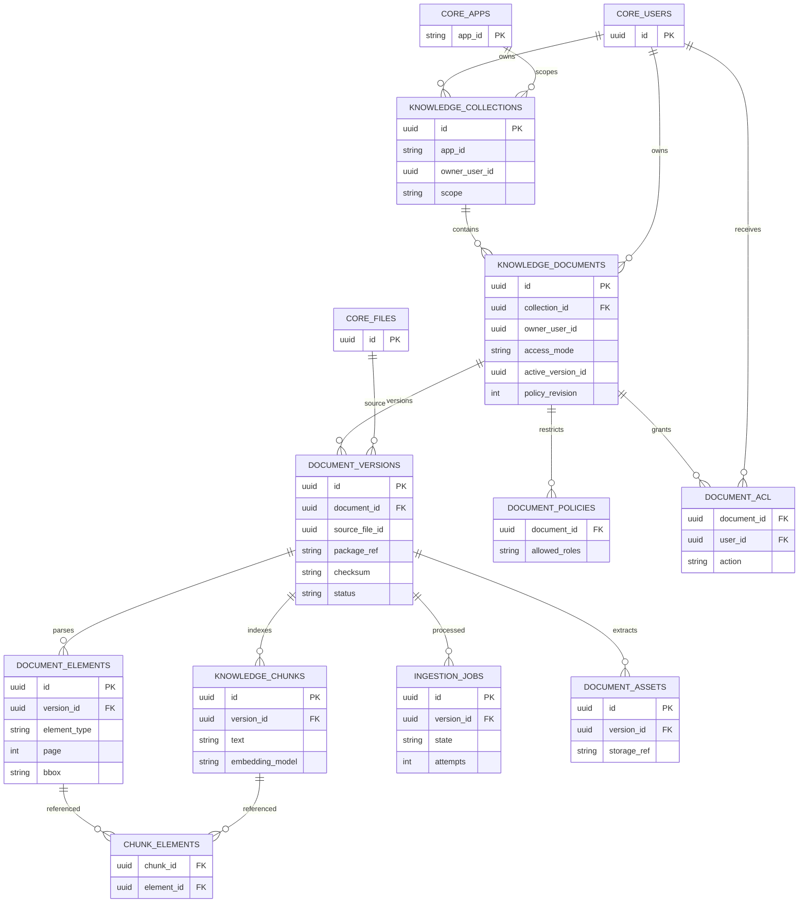
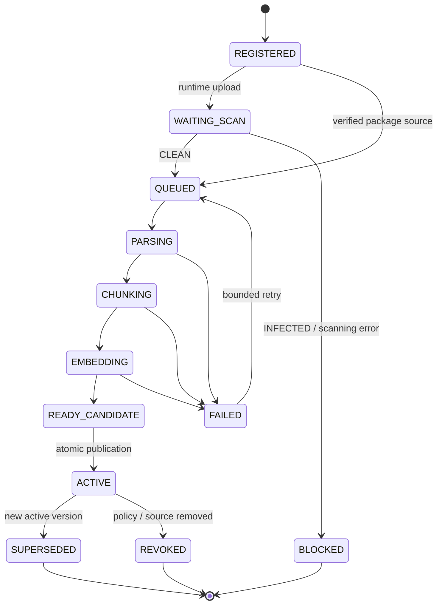

# 03 — Proposed `cap_ai` Data Model and Document Lifecycle

**Status:** all `cap_ai.*` tables in this chapter are **PROPOSED**, not SQL present in the baseline. Existing `cap_ai.sql` registers only the capability.

## 1. Ownership and storage

| Storage | Canonical objects | Notes |
|---|---|---|
| `core.users`, `core.roles`, `core.user_roles`, `core.apps` | Identity and app registry | Existing Tier 1; no content-specific policy embedded here. |
| `core.files` + SeaweedFS | Uploaded source file metadata and immutable original bytes | File Service + ClamAV own scan state. |
| `cap_ai` | Collections, documents, ACL, versions, DocIR elements, chunks, jobs, usage | Capability-specific, optional installation. |
| PostgreSQL `pgvector` + FTS | Derived searchable chunks | May rebuild from immutable sources/DocIR. |
| Optional object assets | Cropped figures/pages/table images and parser outputs | Protected in SeaweedFS, linked by opaque IDs. |
| LLM provider | Receives only authorized, egress-approved context | Not the system of record. |

Tier boundaries do **not** force separate PostgreSQL databases. Use cross-schema FKs when the approved org model makes them valid. For package knowledge, `source_file_id` may be null and `package_ref` identifies a published immutable source; do not invent a file upload user.

## 2. Conceptual ERD

**Diagram convention:** `CORE_*` are existing references; every other node is a proposed `cap_ai` table. ERD simplifies keys and does not encode FK deferral, unique indexes or authorization logic.

## 3. Proposed table responsibilities and invariants

| Table | Suggested fields / constraints |
|---|---|
| `knowledge_collections` | `id`, `app_id?`, `owner_user_id?`, `scope = APP/PERSONAL/PLATFORM`, `status`, `created_at`; enforce scope-specific ownership checks. |
| `knowledge_documents` | `id`, `collection_id`, `owner_user_id`, `title`, `access_mode`, `active_version_id?`, `policy_revision`, `revoked_at?`. |
| `document_versions` | `id`, `document_id`, `source_kind = PACKAGE/UPLOAD`, `source_file_id?`, `package_ref?`, `sha256`, `parser_version`, `created_at`, `state`; CHECK exactly one source reference based on kind. |
| `document_policies` | `document_id`, `allowed_roles` or normalized relation, policy metadata; no client-supplied SQL predicates. |
| `document_acl` | unique `(document_id,user_id,action)`, `granted_by`, `granted_at`; exclude expired/revoked grants. |
| `document_bindings` | optional `(document_id, app_id, entity_type, entity_id)`; require authoritative per-record read check. |
| `document_elements` | `id`, `version_id`, `parent_id?`, `sequence`, `type`, `page`, `bbox`, `text?`, `structured_json?`, `confidence?`. |
| `document_assets` | `id`, `version_id`, `element_id?`, protected `storage_ref`, content type/checksum. |
| `knowledge_chunks` | `id`, `version_id`, `ordinal`, `searchable_text`, `embedding`, `embedding_model`, `content_hash`; index with `pgvector` and lexical FTS. |
| `chunk_elements` | unique `(chunk_id, element_id)`; use for page/section/bounding-box citations. |
| `ingestion_jobs` | idempotency key, `version_id`, `state`, lease, retries, errors, processing profile, checkpoint. |
| `model_profiles` / `model_usage` | model ID and non-secret credential reference; per-operation token counts, estimated cost, app/user scope. See `07`. |

Indexes to evaluate: `(collection_id, active_version_id, access_mode)`, `(document_id, user_id, action)`, `(version_id, ordinal)`, and vector + FTS indexes on READY active chunks. Indexing must never include revoked/inactive versions in authorized search.

## 4. Document version semantics

**Safety:** `document_versions.state=READY_CANDIDATE` does not yet make a version searchable. An atomic DB transaction replaces `knowledge_documents.active_version_id` only after all checks pass. Revocation is an independent policy gate and must block results immediately. Async deletion is cleanup, not enforcement.

## 5. Proposed schema migration sequence

1. **Stop at the org/file ADR gate.** Design migrations relative to the chosen identity and file model, not both.
2. Ensure `pgvector` is enabled through capability provisioning (and actual deployment supports the extension).
3. Create metadata/source/version/ACL tables and FK/index constraints.
4. Add DocIR, chunk and job tables; build indexes concurrently if data is already large.
5. Add model/usage tables and an audit-compatible change event strategy.
6. Write migrations, rollback strategy and focused data-contract tests. Avoid destructive `DROP` on capability disable/reconcile.

Data migrations must preserve existing file identity, hash and history; never relabel an unscanned upload as CLEAN.
