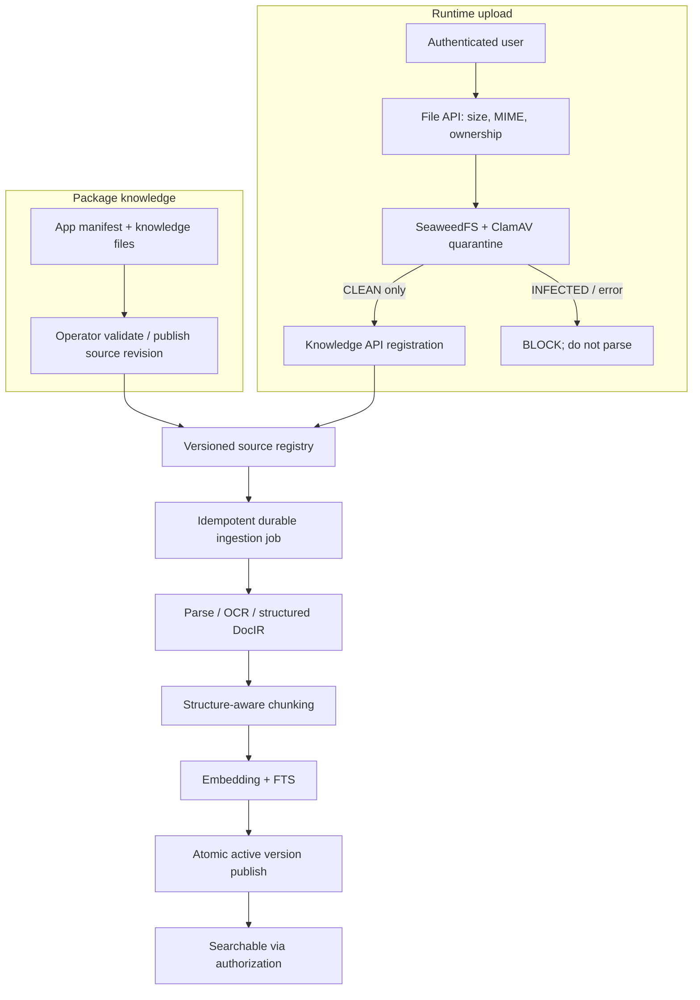
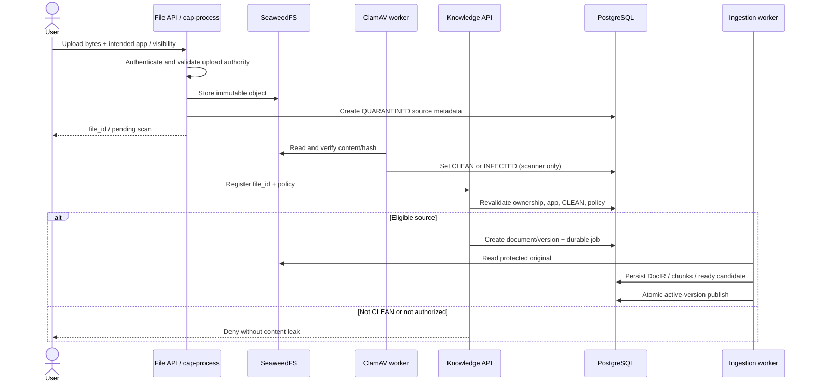
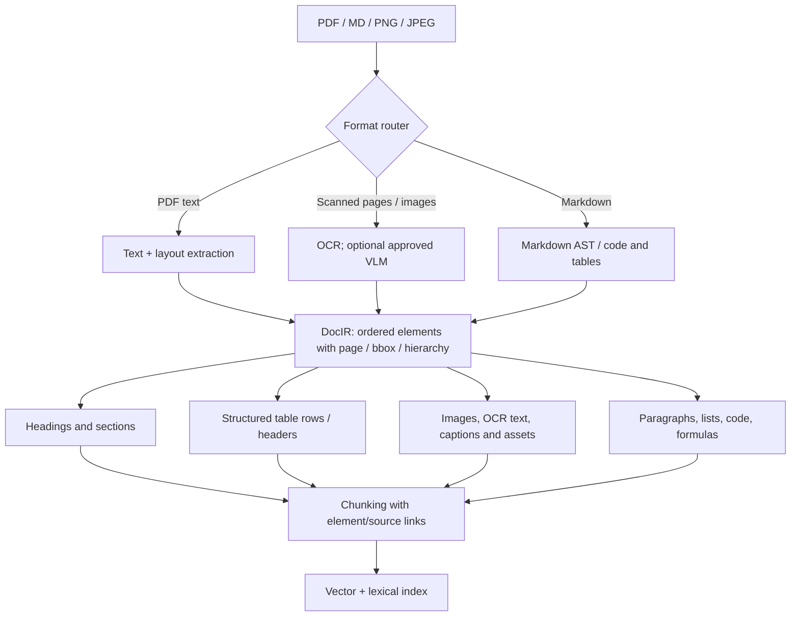
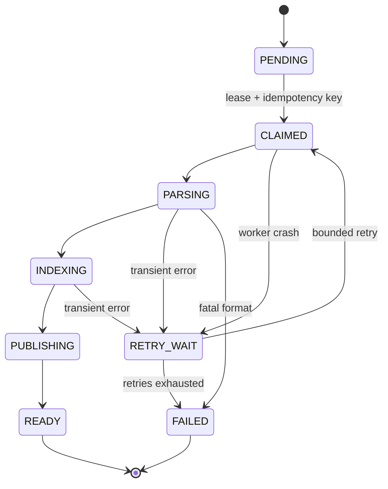

# 04 — App + Runtime Ingestion, Document IR, Tables, Images and Jobs

This chapter covers the full life cycle from an app package or a user's uploaded PDF/Markdown/image to an authorized, indexed document.

## 1. Two entry paths, one pipeline



### Runtime upload sequence



### Package source sequence

```mermaid
sequenceDiagram
    actor Dev as App maintainer
    participant OP as Operator
    participant REG as App publication metadata
    participant K as Knowledge API
    participant Q as Durable jobs
    Dev->>OP: Versioned package with knowledge sources
    OP->>OP: Validate names, paths, checksums, roles
    OP->>REG: Publish only validated Ready config
    OP->>K: Reconcile source declarations by app + version
    K->>Q: Enqueue new/changed sources
    Note over OP,Q: Indexing is asynchronous; old version stays queryable
    Q-->>K: Index candidate READY
    K->>REG: Confirm source belongs to active package revision
    K->>K: Atomically switch document active version
```

The Operator source should be immutable (package revision/hash) and copied to an approved protected object store if runtime must outlive the original filesystem. Never trust package-provided role strings or paths without validating them against registered app roles and safe package boundaries.

## 2. Upload rules

- Only authenticated, app-authorized users register runtime documents; default user-created document visibility is `PRIVATE`.
- **Current code limits uploads to PDF / PNG / JPEG, maximum 20 MiB.** Supporting Markdown is **PROPOSED** and requires synchronized file MIME validation, size policy, server, UI and tests; no bypass via spoofed extensions.
- Detect format by content, not filename only; cap page counts, decompressed size, nested attachments, image pixel count and parse time.
- Preserve original binary and SHA-256. A replacement is a new immutable source identity/version, scanned again.
- A scan exception or timeout keeps a file unclean. Quarantined bytes are not sent to embedding, OCR or external VLM services.
- User-uploaded docs that reference domain records inherit that record's read constraints. A user-uploaded personal doc should never accidentally become available to an entire app role.

## 3. Unified Document Intermediate Representation (DocIR)

The key to heterogeneous documents is **one structured, provenance-preserving IR**, not reducing every source to a flat text blob.



Proposed IR JSON shape (illustrative, no current parser contract):

```json
{
  "document_id": "doc-uuid",
  "version_id": "version-uuid",
  "parser_profile": "pdf-layout-v1",
  "elements": [
    {
      "id": "elem-uuid",
      "type": "table",
      "order": 17,
      "section_path": ["2. Approval Limits"],
      "page": 4,
      "bbox": [62.0, 205.0, 519.0, 395.0],
      "text": "Approval thresholds",
      "structured": {
        "headers": ["Amount", "Approver"],
        "rows": [["Below 10M", "Manager"], ["10M and above", "Director"]]
      },
      "confidence": 0.94
    }
  ]
}
```

Keep both structured data and search-friendly text, plus element and page coordinates. This enables exact citations, original crop preview, table reconstruction and future multimodal search.

## 4. Tables: do not destroy relationships

A table must preserve column headers, row values, merged cells and units. Chunk by **logical rows or row groups**, repeating headers to retain semantics. Example:

| Amount range | Required approver |
|---|---|
| Below 10,000,000 VND | Manager |
| 10,000,000 VND or more | Director |

Search chunk should contain: “Approval thresholds; row: Amount range = 10,000,000 VND or more; Required approver = Director; page 4; section 2.” Avoid splitting “amount” and “approver” into unrelated chunks.

For complex tables: preserve HTML/JSON cell structure, row/column spans, page continuation and a bounding-box-backed visual crop. Use parser confidence flags and a review path for low-confidence OCR.

## 5. Pictures, scans and figures

1. Detect figure regions and source page.
2. Save cropped figure as a **protected derived asset** in SeaweedFS; keep original checksum/provenance.
3. Extract visible text using OCR. Optionally create a VLM caption for diagrams/photos **only when data egress policy permits**.
4. Index text/OCR/caption with `element_id`; do not mistake a generated caption for verified source text.
5. Citations identify document/version/page/figure and open only through an authorized file/asset route.
6. Add VLM usage to provider-funded quota and usage ledger; avoid sending PRIVATE documents externally without policy approval.

## 6. Chunking and index strategy

- Split on section hierarchy, not fixed characters alone. Respect headings, list items, code fences, table row groups and figure captions.
- Attach `document_id`, `version_id`, `app_id`, `section_path`, `element_ids` and page span to each chunk.
- Use measured token limits with controlled overlap; store parser version, chunker version and embedding model/dimension for reproducibility.
- Deduplicate identical binaries/chunks by checksum only **within allowed ownership and ACL boundaries**; never infer permission from shared hashes.
- Support optional multilingual embedding, lexical search and reranking, with quality tests for Vietnamese.
- A model/dimension change requires versioned reindexing; old and new embeddings should not mix in a single incompatible index.

## 7. Durable jobs, retries and reconciliation



Jobs must be retry-safe (unique `(version_id, parser_profile, embedding_model)` or equivalent). Use durable lease/checkpoints, bounded retries and idempotent upserts. An interrupted publish must leave either previous active version or the complete new one, never half-indexed chunks as visible.

## 8. Uninstall/update/delete

- **App update:** diff source manifests/checksums, enqueue changed sources, retain old READY version until new READY; revoke removed source from active search immediately when new app publication takes effect.
- **App uninstall:** revoke registry/policy access; preserve retained evidence/doc history according to explicit retention; do not cascade-delete originals without policy.
- **User document revoke/delete:** deny reads first; hide from search; async purge embeddings/assets; audit and retention rules apply.
- **User permission change:** bump policy revision and invalidate caches; do not require re-embedding.
- **Source re-upload:** new file + scan + document version; never silently modify original bytes.

## 9. Tool choices and responsibilities

- **Docling:** candidate layout-aware parser/OCR adapter, especially complex PDFs.
- **Unstructured:** alternative or supplemental partitioner.
- **RAGFlow:** reference for ingestion/retrieval design, **not selected as mandatory runtime** for this native solution.
- **LlamaIndex / Haystack:** reference retrieval pipeline patterns, not reasons to duplicate orchestration frameworks.
- **PostgreSQL + pgvector:** proposed primary persisted vector store in existing platform DB.

Benchmark with representative Vietnamese PDFs, legal/HR documents, spreadsheets as embedded tables, scans and diagrams before standardizing a parser. No single parser solves every modality perfectly; record fallback paths, confidence and provenance.
