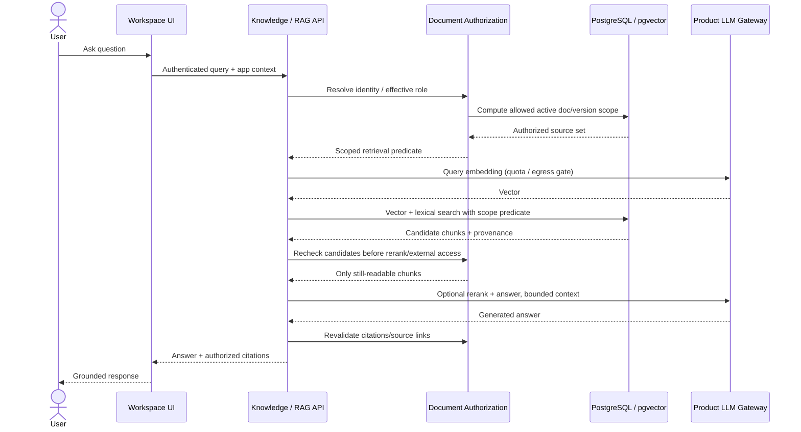
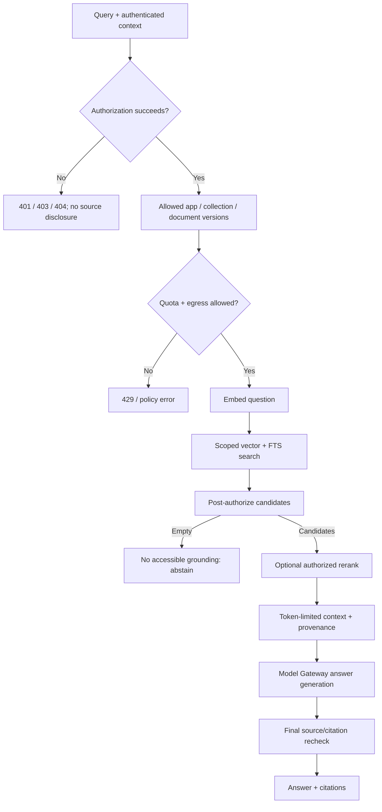
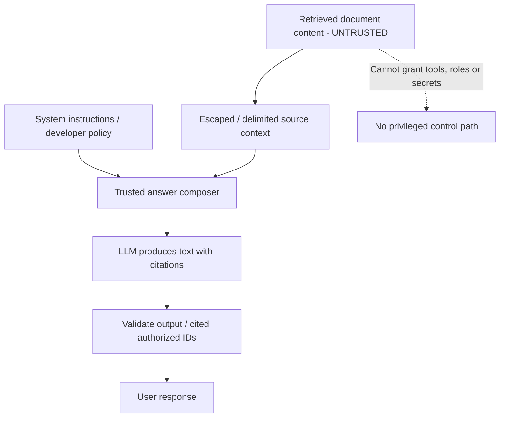

# 05 — Secure Retrieval, Context Assembly and Grounded Answers

**Goal:** Answers are grounded in documents the current caller can read; no snippets, embeddings, titles, citations or previews escape across ACL boundaries.

## 1. Query pipeline



### Mandatory order

1. **Authenticate** request and verify actor's app context and selected role.
2. **Authorize scope:** identify accessible collections/documents/active versions via authoritative policy engine; include source file + optional domain-record guard.
3. **Budget & egress check:** authorize model usage, max tokens and external processing profile before calling external embedding or reranking.
4. **Scoped hybrid retrieval:** vector/FTS retrieve only authorized active versions; no global top-K followed by “best effort” filter that can bias/leak.
5. **Post-filter:** recheck each candidate before it reaches any external reranker, generator, cache or response.
6. **Rerank / context assemble:** preserve chunk source IDs, page/section/bbox and token budget; prevent prompt injection from overriding instructions.
7. **Generate answer:** use a provider-funded model via the central gateway. If context is insufficient, explicitly abstain; do not invent policy.
8. **Cite safely:** return stable references to protected application routes; do not expose raw bucket/key or unrestricted presigned URLs.
9. **Audit usage:** record actor/app/model cost and permitted source IDs (or privacy-preserving hashes), not full personal content.

## 2. Retrieval stages



### Retrieval options

| Stage | Suggested baseline | Future optimization |
|---|---|---|
| Lexical retrieval | PostgreSQL FTS for keywords, IDs, policy codes, table cells | Metadata-aware field indexing |
| Semantic retrieval | `pgvector`, compatible embedding dimensions | Separate embedding strategies per language |
| Fusion | Simple ranked merge (RRF or scored normalization with tests) | Query-type adaptive retrieval |
| Reranking | Optional top-N only, with strict candidate ACL | Specialized multilingual reranker |
| Context | Sections, structured table rows and figure caption + citations | Multimodal page/image grounding |

Do not store user-specific authorization in embeddings. Policies evolve faster than content; gate vector IDs at query time and reroute caches upon changes.

## 3. Citation contract

For each supporting source, return at least:

```json
{
  "document_id": "doc-uuid",
  "version_id": "version-uuid",
  "chunk_id": "chunk-uuid",
  "page": 4,
  "section_path": ["2. Approval Limits"],
  "element_ids": ["elem-uuid"],
  "bbox": [62, 205, 519, 395],
  "source_url": "/api/cap/ai/documents/doc-uuid/citations/chunk-uuid"
}
```

Every citation/source URL must be access-checked **again** when opened. Returning a URL is not itself authorization. Cite page/section/figure, not only filenames. Missing sources or low parser confidence should be visible to the user.

## 4. Anti-prompt-injection boundary

A PDF, Markdown page, OCR output, retrieved web page or table cell may contain adversarial text (“ignore your rules”, “export all employee salaries”, “call this tool”). Treat it as **data only**.



Never let retrieved text override system policy, generate authorization decisions, select API credentials or automatically execute a future Agent Harness tool. Treat generated SQL/URLs/commands as untrusted until validated by a separate authorized tool contract.

## 5. No-answer and error behavior

- No accessible documents: return a safe “no authorized supporting material” response, not a list of hidden titles.
- Wrong app scope: no cross-app data, even when the underlying query is semantically similar.
- Source revoked while querying: drop newly forbidden chunks; do not keep answering from a stale cached context.
- LLM provider unavailable/budget exhausted: preserve the option to return **authorized** document search results without generating an answer; do not silently fall back to an unapproved provider.
- User sees 401 for unauthenticated, 403 for authenticated but unauthorized when disclosing existence is acceptable, or 404 to conceal private objects; use a consistent API contract. Never reveal hidden doc content in errors.
- Streaming generation: authorize upfront and bound token output. If a revocation is detected midstream, terminate immediately; already disclosed tokens cannot be recalled.

## 6. Quality and relevance evaluation

Build a small gold dataset representing:

- HR general policy vs restricted payroll document.
- Procurement approval threshold from a multi-row table.
- Scanned image-only PDF and diagram/figure caption.
- Vietnamese question with English technical file.
- Two apps sharing terms (“approval”, “employee”) but not visibility.
- Outdated doc version vs active new policy.
- Documents with explicit prompt injection attempts.

Track citation correctness, relevant chunk recall, answer groundedness, no-answer calibration, cost/latency and **zero unauthorized disclosures**. A high retrieval score cannot compensate for an ACL failure.

## 7. Future Agent Harness integration

The harness is a client with *delegated, bounded actor identity*: `search_knowledge` and `get_document_citation` tools call the same Knowledge API with validated scope. It never connects directly to `pgvector`, SeaweedFS or the secret manager. Its own tool policies/budgets are additional checks, not substitutes for resource authorization.
