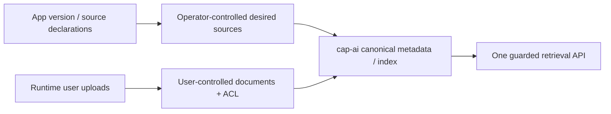
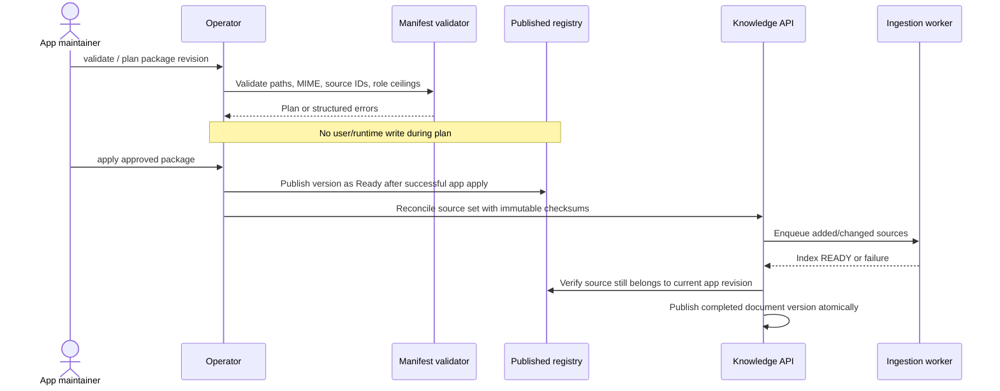
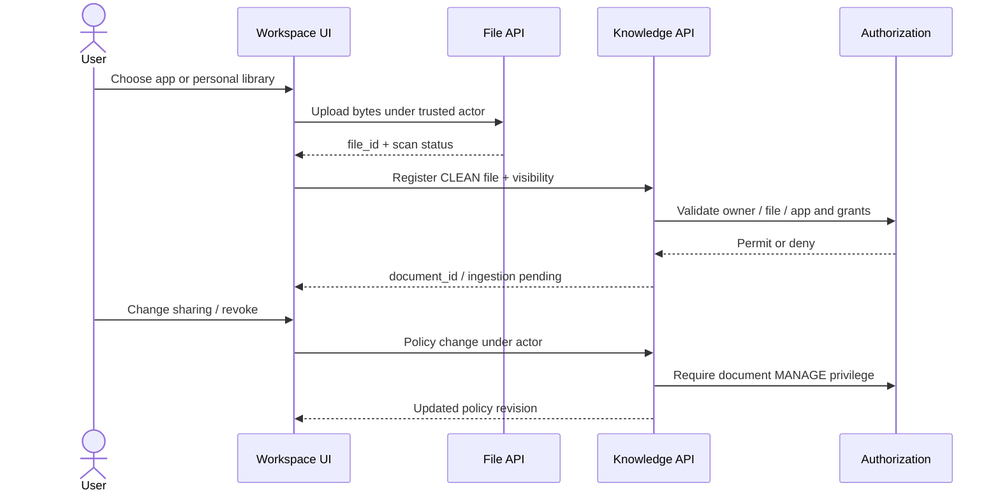

# 06 — Declarative Apps, Operator Sources and Runtime Knowledge

The system must support an app supplying knowledge **at deployment** and users supplying documents **after deployment**, without changing Tier 1 core code for each app.

## 1. Source-of-truth boundary

- **Package-managed knowledge:** desired state is a versioned `apps/<app>/manifest.yaml` plus `knowledge/*` files. Operator validates/publishes immutable source refs and policies.
- **Runtime-managed knowledge:** desired state comes from authenticated user uploads and document management APIs, with ownership/ACL stored in `cap_ai`. Operator must not erase user docs when reconciling an app package.
- **Shared retrieval service:** both source kinds become versioned documents in the same Knowledge API/IR/index, but preserve provenance and different management rights.



## 2. Proposed manifest extension (not currently parsed)

**VERIFIED:** current `operator/internal/manifest/types.go` contains `Spec.Capabilities`, `Attachments`, `Workflows`, etc.; it has no `Knowledge` field. Existing `apps/procurement/knowledge/*.md` exists but is read directly by the current keyword-matching RAG code. This is not an Operator ingestion contract.

**PROPOSED:** add a versioned, validated `spec.knowledge` extension. Illustrative fragment:

```yaml
spec:
  capabilities:
    - cap-ai
  knowledge:
    sources:
      - id: procurement_policy
        file: knowledge/procurement_policy.md
        contentType: text/markdown
        visibility: ROLE
        allowedRoles:
          - role_procurement
          - role_manager_procurement
        indexingProfile: standard-text-v1
      - id: procurement_supplier_guide
        file: knowledge/supplier_guide.pdf
        contentType: application/pdf
        visibility: RESTRICTED
        allowedRoles:
          - role_manager_procurement
        grantManagement: authorized_app_admin
```

Do **not** paste this fragment into a current manifest assuming it is accepted. The parser, validator, planner, stored app spec, reconciliation, OpenAPI/schema generation and tests all require a coordinated versioned change.

Sensitive document ACL membership is not hardcoded in source YAML. The package declares a role *ceiling* and grant-management policy; authorized admins grant named users at runtime. Operator reconciliation may tighten the ceiling or revoke package sources, but must not silently grant all users the right to a restricted document.

Example: [knowledge-extension.proposed.yaml.txt](../examples/knowledge-extension.proposed.yaml.txt).

## 3. Safe Operator workflow



### Plan / apply / reconcile / uninstall

| Operation | Required knowledge behavior |
|---|---|
| `validate` | Reject traversal/symlink escapes, unknown source paths, bad MIME/hash, duplicate IDs, undeclared roles, invalid visibility. |
| `plan` | Produce a deterministic diff (add/update/revoke/unchanged) with **no DB, file or model side effects**. |
| `apply` | Register validated desired revision and publish app config consistently; no sync OCR/embeddings. |
| `reconcile` | Idempotent source diff across all active apps, retaining user-owned docs; no unrelated grants removed. |
| `uninstall / remove` | Stop search access to package sources immediately; defer deletion to explicit retention; personal docs require separate disposition policy. |
| `rollback` | Restore earlier desired package, activate previously indexed eligible source version if still valid; no permission widening by default. |

The pinned current Operator CLI includes `validate`, `plan`, `apply`, `reconcile`, `export-crd` and `controller`. **This does not mean a knowledge adapter is implemented.** Older repository prose claiming `apply` does not exist is outdated relative to `operator/cmd/dxos-operator/main.go`. Verify the checkout before acting.

## 4. Runtime user document management



**Personal library special case:** current SQL requires `core.files.app_id NOT NULL` and a real `core.apps` reference. A cross-app personal library needs an explicit approved source contract. Options: a dedicated managed personal app namespace, or an update to the file model. No arbitrary invented `app_id = NULL` or hidden “system app” bypass.

## 5. Future App UI capabilities

- App-managed “Knowledge” tab: declared package sources with status, citations and per-role visibility.
- User “My Documents” tab: upload, parsing status, private list, revoke/delete; no other users' private files.
- App admin “Document Access” view: grant selected users on RESTRICTED documents, show audit trail.
- Contextual RAG view: choose app and query; source citations link back to secure preview.
- Errors: quarantined, unsupported file, parsing failed, unauthorized and budget reached are distinct.

All UI features read backend authorization; hiding a button is not access control.

## 6. Agent implementation checklist

- [ ] Resolve manifest versioning and the `spec.knowledge` serialization via contract/ADR change.
- [ ] Add parser/validator types; validation tests including path traversal, duplicate source IDs and undeclared roles.
- [ ] Add deterministic plan diff and idempotent apply/reconcile adapter to Knowledge API.
- [ ] Test operator down while runtime search still works.
- [ ] Test failed indexing keeps previous source active; remove/uninstall hides revoked docs immediately.
- [ ] Test runtime user documents survive unrelated app reconciliation.
