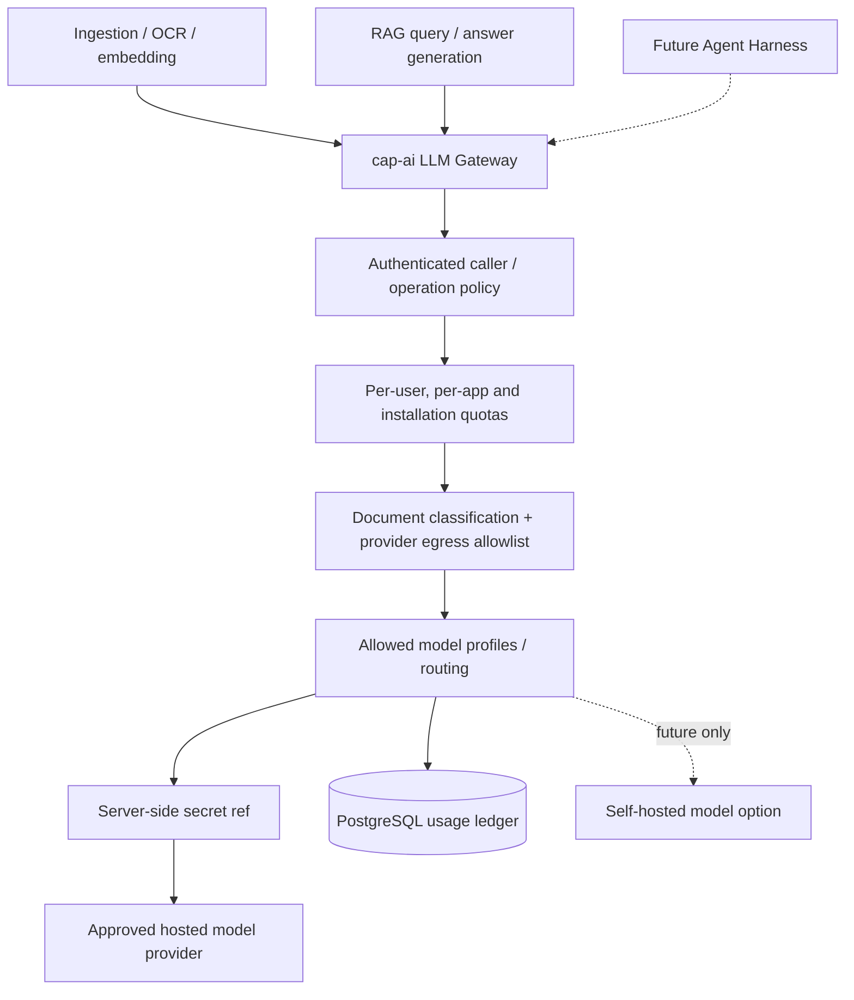
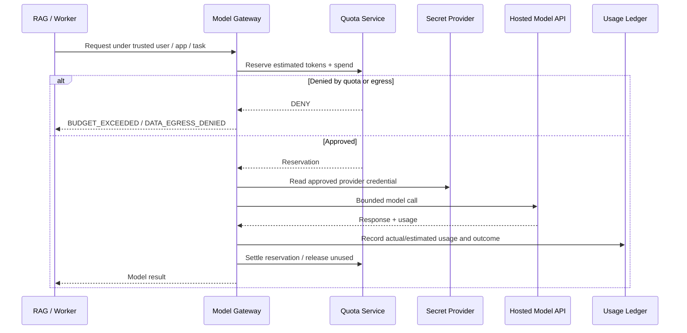

# 07 — LLM Gateway: Product Provider Funds All Models

**FINAL PRODUCT CHOICE for this package:** The OpenDX-OS **product provider** pays and operates all model inference and embedding usage. Users and deployment organizations **do not** enter their own API keys in MVP. BYOK and per-organization custom providers are deferred, not active options.

## 1. Centralized model architecture

The gateway mediates *every* external model call: document image analysis, optional OCR/VLM, embeddings, reranking and chat generation. Some CPU-only local OCR parsing may not call a model. No app manifest, frontend or document may choose an arbitrary provider URL, secret reference or privileged model profile.

## 2. Responsibilities

| Concern | Model Gateway responsibility |
|---|---|
| Credentials | Product-owned API keys, stored in approved server-side secret management / deployment secret; never returned to UI or logs. |
| Model registry | Stable `model_profile_id`, provider, model, purpose, embedding dimension, allowed data classifications, enabled status. |
| Quotas | Per user/app/installation request, token and spend budgets; max concurrency and rate limits. |
| Metering | Input/output tokens, requests, retry count, model ID, actor/app, cost estimate, outcome and latency, not document contents. |
| Routing | Allowlisted models and bounded fallback according to privacy/cost policy; no automatic “send elsewhere” when blocked. |
| Data egress | Do not send sensitive PRIVATE/RESTRICTED content to unapproved providers; explicit approved processing policy is required. |
| Failure | Fail safely on exhausted quota/secret/provider outage; search may still return authorized citations without generation. |

## 3. Budget enforcement

Implementation details: reserve enough budget **before** model call to prevent concurrent overspend, not just count after completion. Track uncertainty between provider billing and local estimates; alert on invoice discrepancies. Bound retries and do not double-charge successful idempotent requests in usage reporting. If the budget service is unavailable, do not make unlimited external calls.

## 4. MVP provider profile policy

For OLP, keep it small:

- One admin-configured generation profile and one embedding profile; optional local OCR where possible.
- One product-owned hosted provider credential, rotated/revocable without app-package edits.
- Per-user daily requests, per-app monthly tokens, installation-wide spend ceiling and per-request token/context limit.
- Usage ledger + aggregate admin dashboard; no API keys, full prompts or document bodies in usage rows.
- Explicit kill switch to disable external inference and retain authorized search-only mode.

**Do not build:** user key-entry screen, organization key vault, arbitrary model marketplace, open proxy to user-supplied URLs, or unlimited agent loop.

## 5. Provider privacy and operating model

Product-funded does not mean permission to transmit every private document. Model egress can be governed separately:

- `PUBLIC/INTERNAL`: approved hosted model if contractual/data policy allows.
- `SENSITIVE/RESTRICTED/PRIVATE`: possibly allowed only to an explicitly approved provider/data-processing policy; otherwise return `EXTERNAL_PROCESSING_NOT_ALLOWED` or use a separately approved local model in the future.
- Redact secrets/PII if required, but do not assume redaction makes every document safe.
- Log only necessary metadata; evaluate provider retention and localization before production deployment.
- Model-generated captions are tagged as synthetic and may be wrong; keep original source as truth.

## 6. Storage and keys

- **PostgreSQL (`cap_ai.model_profiles`):** provider ID, model alias, purpose, enabled flag, cost config and **`credential_ref` only**.
- **Secret manager/deployment secret:** actual provider API key. OpenBao can be evaluated; repo docs currently use OpenBao for audit anchors, so do not claim a completed API key vault integration.
- **Model Gateway process:** accesses secret with least privilege, rate-limited and audited.
- **User/UI/manifest:** no credential values or custom provider URLs.

## 7. Migration and future extensibility

If future product needs organization BYOK or self-hosted models, introduce a new explicit ADR and a versioned provider trust/egress contract. Current MVP keys remain product-owned; changing cost bearer also affects billing, quotas, UI, privacy, support and secret ownership.

Future Agent Harness must pass user/app context and per-run budget to the gateway. It cannot increase role access by using the product-paid model.
