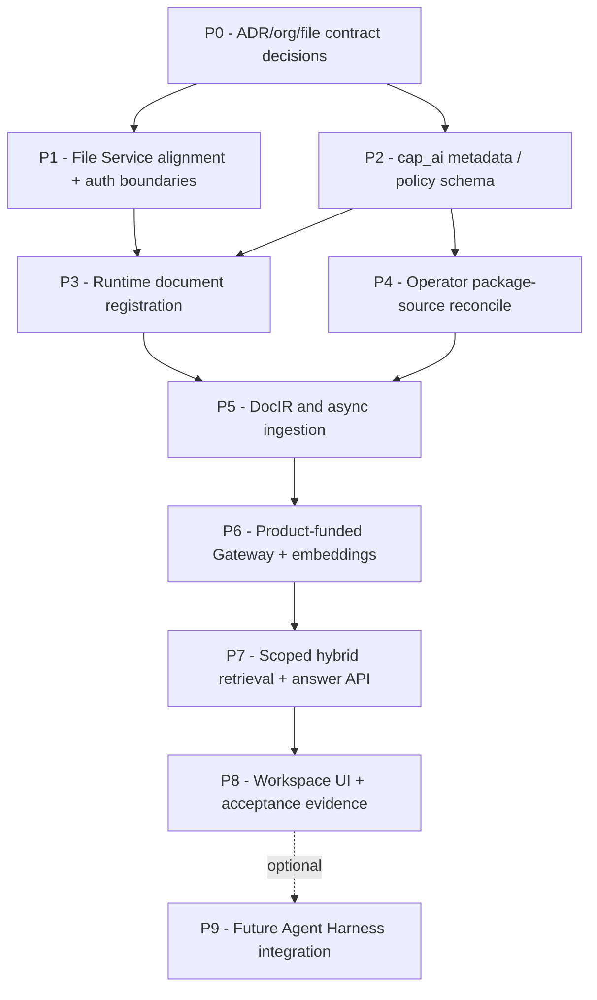

# 09 — Incremental Implementation Roadmap for Coding Agents

Do **not** attempt to ship full RAG, new permissions, file migration, Operator extension, OCR, quotas and Agent Harness in one change. Each phase below has a bounded scope, dependencies, code touch points and evidence.

## 1. Dependency graph



### P0 — Contract reconciliation / ADR

**Scope:** architecture decision, not destructive code.

- Inspect latest `AGENTS.md`, ADR 0001/0003, data/security contracts and current SQL.
- Decide one-organization installation vs multi-workspace. Identify migration/compatibility steps, especially file/role/app identifiers and Hasura claims.
- Decide personal-library ownership across apps and source-file access contract.
- Document how a trusted actor's roles and app context are computed; define narrow operator/worker service identity.
- Decide where doc-specific ACL sits (recommended `cap_ai`) and whether external model egress for PRIVATE documents is permitted.
- Update accepted decision/contracts via repository's ADR workflow **only when authorized**.

**Exit:** accepted authoritative data/authorization contract, affected consumers listed, no silent mismatch.

### P1 — Align File Service and scanning

**Scope:** `core.files`/File API contract, scanner and download guards.

- Migrate/align runtime `core.file_objects` queries or adapt schema **only per P0 decision**.
- Keep immutable object identity/hash, `QUARANTINED → CLEAN/INFECTED` trust boundary.
- Add Markdown MIME when supported, with content-based validation and safe size/page restrictions.
- Verify an actor can upload/list/download only within allowed app/source scope.
- Negative tests for spoofed MIME, unclean file, tampered hash and cross-app download.

**Exit:** coherent runtime file API and DB; zero source access bypass; S06 evidence.

### P2 — Knowledge metadata + policy

**Scope:** `cap_ai` migrations, repository adapters, authorization evaluator.

- Collections, document/source versions, ACL, active version, policy revision, scope constraints.
- Use approved core identities and FKs; no shared core pollution.
- Implement per-document PRIVATE/ROLE/RESTRICTED policy and source/record read guards.
- Unit/integration tests covering HR selective access and private owner-only.
- Add permission-aware audit events and revocation policy gate.

**Exit:** deterministic policy decisions and DB constraints tested with running PostgreSQL.

### P3 — Runtime upload registration

**Scope:** authenticated Knowledge API + File Service integration.

- Register only authorized CLEAN source or WAITING_SCAN with no premature access.
- Create idempotent document+version+durable job in one transaction.
- Add list/status/visibility and restrict grant endpoints by MANAGE authority.
- No rich parser needed yet; mock job transition to test lifecycle.
- Test replay/key mismatch and revocation during pending ingestion.

**Exit:** user/private and HR restricted document lifecycle can be demonstrated end-to-end (without LLM yet).

### P4 — Operator package knowledge

**Scope:** source declaration serialization and control-plane adapter.

- Extend `DXApplication` contract/schema/validator; package path/checksum/roles/source IDs.
- Plan deterministic add/change/revoke diff, apply/reconcile after ready publication.
- Never reinitialize user documents or run model calls in Operator transaction.
- Test idempotent repeated reconcile, failed source update, rollback and app removal.
- Keep old runtime knowledge active on indexing failure; revoke removed sources at publication boundary.

**Exit:** adding a new app + policy document requires no shared service special cases.

### P5 — Ingestion + DocIR + lexical indexing

**Scope:** workers and parser adapter (e.g. Docling), DocIR schema.

- Start with Markdown + text-based PDF; then OCR scans, tables, images/captions.
- Preserve hierarchy, table header/row relation, figure crop, page/bbox citation links.
- Durable job leases, bounded retries, failed/partial state and atomic active-version switching.
- Persist structured chunks and PostgreSQL full-text search entries; no external
  embedding calls until the central Model Gateway exists.
- Record parser/chunker version and future embedding dimension metadata.
- Quality test threshold policies and image-only PDF; no parsing for blocked sources.

**Exit:** reproducible, cited document chunks for both source kinds with failure recovery.

### P6 — Product-funded Model Gateway + embeddings

**Scope:** server-side provider credentials, quota/egress enforcement, embedding adapters,
`pgvector` indexing and usage metering.

- Configure one approved generation profile and one compatible embedding profile,
  never caller-provided API keys or URLs.
- Implement reservation/settlement for per-user, app and installation usage budgets;
  use server-side secret references and enforce data-classification egress policy.
- Embed only documents already authorized for external processing and READY,
  using versioned model/dimension metadata and derived index publication.
- Test key isolation, quota exhaustion, redaction/logging, provider outage and
  rejected private-document egress.

**Exit:** all external model calls are centrally controlled; embeddings and model
costs are auditable, and unsafe egress is blocked.

### P7 — Scoped retrieval, citations and answer generation

**Scope:** end-to-end authorized search, hybrid retrieval, protected citation routes
and grounded generation using P6 model profiles.

- Enforce role+ACL+record/file permission *before* vector/FTS and again before
  reranking, model context and citation download.
- Do not build an unrestricted global search endpoint, direct vector client
  or public figure/table asset route.
- Implement policy-revision-aware cache/invalidation and bounded prompt context.
- Test cross-app and cross-user leakage, revocation race, prompt injection,
  stale versions and protected citation deep links.
- Provide authorized search-only fallback when generation is unavailable.

**Exit:** grounded answer demo with measured cost and confidential content not exposed.

### P8 — UI and full acceptance

**Scope:** document list, upload, policy/ACL management, statuses, RAG chat/citations.

- Personal library, role-aware document tab and restricted document grants.
- Callers bypassing UI are also denied by backend.
- Verify real Keycloak/APISIX (where deployed), PostgreSQL/pgvector, File Service/storage, parser and model error paths.
- Run relevant repository tests; record S01/S06 and RAG-specific evidence.

**Exit:** documented MVP demo with reproducible fixtures, rollback and known gaps.

### P9 — Future Agent Harness (separate project increment)

- Connect tools to secure Knowledge API and Model Gateway with delegated identity and budgets.
- Add tool allowlists and per-run approval policy; **do not** give autonomous agent elevated root credentials.
- Maintain complete audit of tool calls and model usage.
- Only add after P6/P7 access enforcement is qualified.

## 2. OLP-focused MVP scope

**Demo-critical:** one package knowledge source, one private user file, one RESTRICTED HR-like file, one text-based PDF with a table, clean/quarantine controls, approved provider-funded answer with citation, and verified denied queries.

**Stretch:** complex scanned chart OCR/VLM, multi-page merged tables, full billing dashboard, self-hosted model, Agent Harness, large corpus perf. Keep representative confidence/provenance even when a parser fallback is not complete.

## 3. Agent task template

```text
Task: Implement P<N> only.
Read: repo AGENTS.md, architecture ADR/contracts, this guide sections 01-11.
Precondition: explicitly list accepted organization/file/identity decisions.
Affected producer / consumer:
Minimal change and migration:
Authorization invariants:
Test plan including negative ACL cases:
Exit criteria:
Do not modify unrelated apps or overwrite uncommitted work.
Do not declare success for unrun integration tests.
```

## 4. Rollout and reversibility

- Add capability schema through versioned migration; never drop retained data on disable/reconcile.
- Behind deployment flags/capability registry, introduce new APIs gradually; secure/deprecate legacy unscoped RAG route.
- Workers use immutable snapshots; app and doc rollback activate a verified previous version.
- Feature can switch to authorized search-only mode when model provider or budget unavailable.
- Track parser/embedding version and index reprocessing migration separately from canonical originals.
