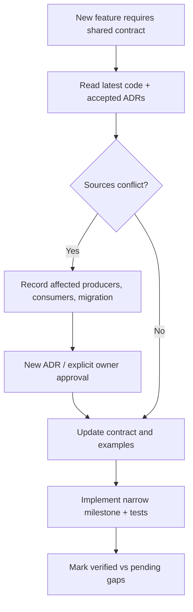

# 11 — Verified Repository Baseline, Contradictions and Decision Register

**Repository:** https://github.com/nguyentin05/opendx-os  
**Verified branch:** `feat/db-org-model`  
**Pinned HEAD read:** `23098cd324fc678dc321abf67d56b845f4aeb29b` on **2026-11-13**.  
**Scope of verification:** selective GitHub source and docs reading; **no live DB migration, integration test or runtime security test performed** for this design package.

Agents must re-read branch/HEAD before changes. This snapshot is a starting point, not a guarantee that HEAD remains unchanged.

## 1. Evidence ledger

| Source path | Observed fact | Classification |
|---|---|---|
| [AGENTS.md](https://github.com/nguyentin05/opendx-os/blob/feat/db-org-model/AGENTS.md) | Repo instructions: use relevant sources, document English, preserve ADR/contracts | VERIFIED |
| [README.md](https://github.com/nguyentin05/opendx-os/blob/feat/db-org-model/README.md) | Three-tier development is partial; full integration unqualified | VERIFIED |
| [platform/postgres/init/01_core_schema.sql](https://github.com/nguyentin05/opendx-os/blob/feat/db-org-model/platform/postgres/init/01_core_schema.sql) | One-organization-per-installation; `core.users`, `core.files`, app-bound `app_id`, PDF/PNG/JPEG up to 20 MiB | VERIFIED |
| [platform/postgres/init/03_app_registry.sql](https://github.com/nguyentin05/opendx-os/blob/feat/db-org-model/platform/postgres/init/03_app_registry.sql) | `core.apps`, `core.roles`, `core.user_roles`, role ownership | VERIFIED |
| [platform/postgres/capabilities/cap_ai.sql](https://github.com/nguyentin05/opendx-os/blob/feat/db-org-model/platform/postgres/capabilities/cap_ai.sql) | Registers `cap-ai` only; no `cap_ai.knowledge_*` schema | VERIFIED |
| [capabilities/internal/ai/ai.go](https://github.com/nguyentin05/opendx-os/blob/feat/db-org-model/capabilities/internal/ai/ai.go) | Keyword matches local Markdown files; OCR returns mock fields; old file query | VERIFIED |
| [capabilities/cmd/cap-ai/main.go](https://github.com/nguyentin05/opendx-os/blob/feat/db-org-model/capabilities/cmd/cap-ai/main.go) | `/rag` does not call authenticated identity extraction | VERIFIED |
| [capabilities/internal/files/service.go](https://github.com/nguyentin05/opendx-os/blob/feat/db-org-model/capabilities/internal/files/service.go) | Uses old `core.file_objects` + `workspace_id`; enforces PDF/PNG/JPEG upload | VERIFIED |
| [operator/cmd/dxos-operator/main.go](https://github.com/nguyentin05/opendx-os/blob/feat/db-org-model/operator/cmd/dxos-operator/main.go) | CLI has `validate`, `plan`, `apply`, `reconcile`, `export-crd`, `controller` | VERIFIED |
| [operator/internal/manifest/types.go](https://github.com/nguyentin05/opendx-os/blob/feat/db-org-model/operator/internal/manifest/types.go) | No `spec.knowledge` field today | VERIFIED |
| [apps/procurement/manifest.yaml](https://github.com/nguyentin05/opendx-os/blob/feat/db-org-model/apps/procurement/manifest.yaml) | Older workspace-based sample fields and `core.file_objects` reference | VERIFIED |
| [docs/architecture/README.md](https://github.com/nguyentin05/opendx-os/blob/feat/db-org-model/docs/architecture/README.md) | Three-tier ownership, ADR change process, workspace-oriented intended behavior | INTENDED CONTRACT |
| [docs/contracts/data-contracts.md](https://github.com/nguyentin05/opendx-os/blob/feat/db-org-model/docs/contracts/data-contracts.md) | `workspace_id`, `core.workspaces` and `core.file_objects`; logical manifest contract | INTENDED CONTRACT |
| [docs/contracts/security-and-acceptance.md](https://github.com/nguyentin05/opendx-os/blob/feat/db-org-model/docs/contracts/security-and-acceptance.md) | Workspace/role isolation, file CLEAN, RAG source authorization, S01–S08 | INTENDED CONTRACT |
| [ADR 0001](https://github.com/nguyentin05/opendx-os/blob/feat/db-org-model/docs/adr/0001-three-tier-composable-architecture.md) | Accepted three tiers, workspace-based data model | ACCEPTED ADR |
| [ADR 0003](https://github.com/nguyentin05/opendx-os/blob/feat/db-org-model/docs/adr/0003-modular-capability-schema-separation-for-iot-data.md) | Accepted core/capability separation, still old workspace terms | ACCEPTED ADR |

## 2. Conflicts that must not be auto-resolved

### C01 — Organization model

**SQL:** one organization per installation, `core.files.app_id`, `core.users`, `core.roles`, `core.apps`.  
**Accepted ADR/contracts:** workspace-per-row data model with `workspace_id` and composite FKs.  
**Required decision:** explicitly supersede/refine accepted ADRs and update contracts/examples/Hasura/session/runtime code. A newer SQL file alone is not proof of a completed architectural decision.

### C02 — File Service schema mismatch

**SQL:** `core.files` with app-bound metadata.  
**Runtime File Service + AI extraction:** `core.file_objects`, `workspace_id`.  
**Required decision:** migration plan for old names, object identities, JWT claims, file API, scanner, download and cross-schema FKs. Do not solve by making File Service run as superuser.

### C03 — Personal documents across apps

**SQL:** `core.files.app_id NOT NULL` referencing `core.apps`.  
**Requirement:** a user may upload personal docs visible only to themselves, potentially outside an individual app.  
**Options requiring product decision:** a dedicated personal application namespace with approved rules, or a versioned generic file source contract. Prefer the smallest coherent solution; avoid ad hoc fake app IDs or weakening FK.

### C04 — Permission granularity

**Code:** core roles/user-role membership, no universal `core.permissions` table.  
**Requirement:** some HR-role users see payroll, others do not.  
**Recommended design:** capability-owned `document_policies` + named-user `document_acl` (role AND grant); cross-service semantic permissions remain separate future ADR. Grant management must be explicit.

### C05 — Model data egress policy

**Chosen economics:** product provider fully pays, no user/org API keys.  
**Separate security choice:** may PRIVATE/RESTRICTED data be sent to approved hosted model? If yes, which provider policies/data classes? If no, safe refusal or approved on-premise runtime. Do not conflate who pays with who may access private content.

### C06 — Operator serialization

**Current:** parser has no `spec.knowledge` and indexed package docs do not use Operator.  
**Proposal:** add declarative versioned knowledge sources, immutable package provenance, validation and async reconciliation. Requires parser + planner + contract updates, not a YAML-only change.

### C07 — Documentation vs actual Operator CLI

**Some docs:** `apply` not yet implemented.  
**Current source:** `operator/cmd/dxos-operator/main.go` includes `runApplyCmd` and lifecycle wiring.  
**Action:** trust current code for command existence; validate its real behavior with tests. Update stale docs when work is authorized.

## 3. Decision protocol

Document a decision with status **PROPOSED / ACCEPTED / SUPERSEDED**, context, options, security/compatibility effect, consumers and migration. Do not treat this package as an accepted ADR.

## 4. External open-source reference repositories

Use official repositories as design inspiration; they are **not** dependencies authorized for installation solely by this guide.

- [Docling](https://github.com/docling-project/docling): document parsing and structured representation patterns.
- [Unstructured](https://github.com/Unstructured-IO/unstructured): multimodal element partitioning reference.
- [RAGFlow](https://github.com/infiniflow/ragflow): document-centric ingestion/retrieval reference, not mandatory runtime component.
- [LlamaIndex](https://github.com/run-llama/llama_index): ingestion/retriever abstractions reference.
- [Haystack](https://github.com/deepset-ai/haystack): modular retrieval/reranking pipeline reference.
- [pgvector](https://github.com/pgvector/pgvector): PostgreSQL vector extension and indexing.
- [Mermaid](https://mermaid.js.org/): diagram authoring in GitHub Markdown.

Before choosing a specific version/feature/license, inspect its current official docs, release and dependency footprint. Security and deployment claims cannot be inferred from name recognition.

## 5. What this package does NOT claim

- No `cap_ai` knowledge schema is implemented.
- No multi-modal ingestion pipeline, document ACL enforcement or product LLM Gateway is implemented.
- No actual cloud provider/key arrangement is configured.
- No runtime permission, malware scan, concurrency or model-cost qualification has been run for the proposed design.
- No Agent Harness integration has been implemented by this documentation.

This distinction is a deliberate acceptance requirement, not an implementation defect hidden by wording.
